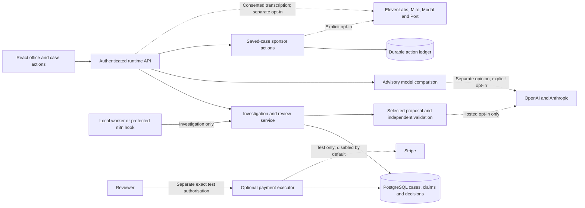
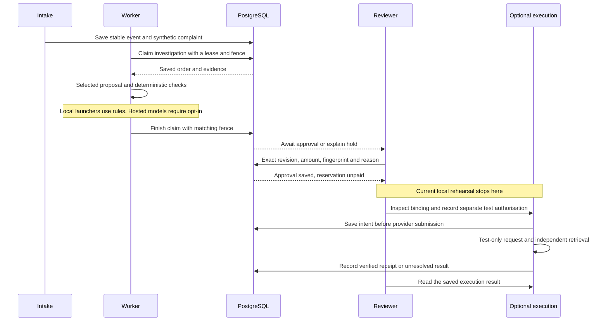

# System Architecture: Refund Office

## Overview

Refund Office is a web application for investigating synthetic refund requests and recording human decisions. A React miniature office presents the saved workflow, evidence, policy checks and outputs. A supplementary Case canvas, local record-based chat and saved-history replay help inspect those records. The service and database own the financial state; desk activity, canvas layout and playback reflect saved state and cannot grant refund authority.

The original local application uses SQLite and simulated payments. Separate PostgreSQL rehearsals add role checks, durable investigation claims, clarification and retained demo runs. A prepared hosted path uses a Vercel function with Supabase identity and storage. The owner has authorised initial hosting for their use only, in a new synthetic workspace with local analysis and payment execution disabled. Hosted sign-in, membership restrictions, persistence, API routing and usability have not been verified. Other integrations and Arize uploads remain off; local checks do not establish account acceptance.

The [initial cloud setup record](docs/verification-initial-cloud-setup-2026-10-15.md) confirms the fresh Supabase operational schema and focused synthetic pack. This is database preparation only: application identities, membership isolation, the investigator invocation and Vercel routing still need acceptance. Optional payment-execution migrations were not applied.

## Key requirements

- Investigate complaints against saved order, packing, delivery and prior-remedy records.
- Validate evidence citations, exact integer-pence amounts, policy limits, duplicates and remaining balances independently of any model.
- Require explicit human approval for each refund, bound to the exact case, amount, evidence, policy and revision. Changed facts require renewed review.
- Separate investigation, review and payment-execution permissions in the service and database.
- Save command and external-write identities before requests; preserve uncertain results until independently checked.
- Produce a readable decision brief, evidence packet and actual event history without inventing reasoning, approvals or provider receipts.
- Keep synthetic datasets and local rehearsals isolated, durable and recoverable. A reset must retain prior decisions and evidence.
- Keep provider calls off unless explicitly enabled for their particular purpose. Credentials alone cannot activate them.
- Treat canvas interaction, local chat, replay and reports as inspection tools. They cannot change evidence or authorise payments.
- Bound requests, recording size, worker claims and trace retention. Production capacity and recovery targets remain unmeasured.

## High-level architecture

The web client calls a case API backed by one application service and a selected store. The original SQLite path has its own legacy engine. The newer PostgreSQL and prepared hosted paths share investigation and review logic, with SQL enforcing transaction boundaries. A database intake table provides work claims; there is no separate message broker. Optional adapters sit outside this core and require their own activation gates.

The diagram shows the prepared PostgreSQL and hosted boundaries. Solid connections carry application reads and writes; dotted connections identify optional provider requests. Approval and payment execution remain separate responsibilities. It does not show a verified external connection.

The separate [sponsor runtime map](docs/diagrams/sponsor-runtime.html) explains these prepared boundaries. The [original map](docs/diagrams/refund-office.html) remains a 13 October snapshot of the SQLite workflow. The [source notes](docs/diagrams/sponsor-runtime.sources.md) identify inspected working files and scope. The maps describe source-level boundaries, rather than proving deployment or account connectivity.

## Component details

The following table identifies each component's responsibility, technology, owned state and communication boundary. Ownership of a view or derived output does not give it authority over the underlying case records.

| Component | Responsibility and technology | Important owned data | Communication |
| --- | --- | --- | --- |
| Office interface | React 19 and Vite views for queues, evidence, review and output inspection | Transient view state and exact pending commands in tab session storage | JSON case API and guarded report/export downloads |
| Case canvas | Lazy-loaded React dialog with connected cards and an accessible list | In-memory layout, camera, selection and search state | Validated provenance export and allowlisted current-case record routes |
| Canvas chat and voice input | Deterministic JavaScript answers; browser MediaRecorder; server-side ElevenLabs adapter | In-memory questions, answers and bounded recording; no saved chat or evidence | Saved map reads; separately consented case-scoped transcription request |
| Saved-history replay | React playback of actual saved event order | In-memory playback position and loaded snapshot | Read-only callbacks supplied by the office; no API client |
| Illustrated System map | React native dialog containing the prepared Archify viewer | In-memory open and loading state; no case records | Static HTML in an isolated iframe; no application API or financial callbacks |
| Original SQLite application | Node.js HTTP API, legacy investigation engine and local payment simulator | Original case documents, settings, intake events, operations and receipts | Browser requests, SQLite transactions and explicitly selected legacy adapters |
| Local PostgreSQL application | Node.js runtime API, local sessions and shared application service | Expiring local sessions, worker lifecycle and rehearsal configuration | Restricted local transport to SQL functions in an isolated PostgreSQL container |
| Operational data stores | SQLite and PostgreSQL persistence, SQL constraints and workflow functions | Durable cases, evidence, events, claims, decisions, operations and replay commands | Repository calls; hosted Supabase RPCs under the verified user identity |
| Unsent clarification questions | Deterministic server builder over one saved packet | Derived wording and evidence-digest binding; no sent-message record | Read-only authenticated customer-draft route |
| Received clarification | Node.js validation and additive SQL transaction | Appended received statement, source, actor, command and superseded investigation | Reviewer-only evidence-request route and requeued investigation |
| Fresh synthetic run | Local Node.js supervisor and reset controller | Durable reset journal, retained volumes, checkpoints and preview metadata | Run-guarded API proxy, rehearsal process lifecycle and minimal reset status reads |
| Hosted identity, API and intake | Request-scoped Node.js handler, Supabase Auth and PostgreSQL | Encrypted session cookie; durable session metadata without provider tokens | HTTPS API, Supabase identity/RPC requests and protected machine intake hook |
| Selected investigation analyser | Local rules or explicitly selected OpenAI/Anthropic structured proposal adapter | Transient proposal and configured provenance; saved outcome belongs to the case store | Shared investigation service followed by independent application and SQL validation |
| Advisory comparison | Separate saved-packet analysis with local rules or optional model proposals | Returned advisory result and actual availability events | Expected-revision packet reads and explicitly enabled provider calls |
| Saved-case sponsor actions | Node.js adapters for ElevenLabs, Miro, Modal and Port | Bound commands, expected object identities, acknowledgements and results in an action ledger | Explicitly enabled provider requests followed by independent retrieval where supported |
| Optional Stripe test executor | Separate Node.js execution facade and SQL contract | Exact authorisation, test mapping, immutable payload, retry key, fenced claim and receipt record | Reviewer authorisation, executor-only commands and Stripe test submission/retrieval |

### Office interface

[App.jsx](src/App.jsx), [RuntimeAccess.jsx](src/RuntimeAccess.jsx), [IntakeOffice.jsx](src/IntakeOffice.jsx), [SponsorActions.jsx](src/SponsorActions.jsx), [PaymentAuthorisation.jsx](src/PaymentAuthorisation.jsx) and [EvidenceClarification.jsx](src/EvidenceClarification.jsx) render the office, access screen, evidence, reviews, briefing, sponsor actions, test-payment results and received statements. The client displays saved snapshots rather than maintaining a second financial state machine. [payment-authorisation.js](src/payment-authorisation.js) validates the exact payment binding and returned execution; [clarification-state.js](src/clarification-state.js) validates the statement command and independently read history.

Pending review commands retain their original identity and exact payload in session storage. The prepared hosted payment screen also retains a separate authorisation command, scoped to workspace, reviewer and case. A lost response remains unresolved; lookup can recover the saved execution, and an original retry keeps the same facts and command. Sign-out clears visible cases. Investigators can inspect recommendations and recover investigations, but do not receive approval or execution controls. These UI restrictions supplement database checks.

The intake dialog receives the selected API's capabilities and worker status. Local automatic processing keeps its background-investigation wording; a hosted or unconfirmed worker leaves the request visibly queued for an authorised investigator. This display choice does not start a worker or grant investigation permissions.

The local profile chooser is a rehearsal convenience, not real authentication. The separately built hosted interface uses the verified session contract and does not offer local profile selection. Motion remains optional and respects reduced-motion preferences.

[CaseInbox.jsx](src/CaseInbox.jsx) and [case-view.js](src/case-view.js) classify saved cases into decision, evidence, recovery and other-hold queues. Classification and next-case selection are presentation only and respect the current role. Conflicting approvals or reservation records remain inspection holds. Queue navigation reads a case; the original manually driven SQLite investigation must be paused explicitly before switching through this view.

[CustomerDraft.jsx](src/CustomerDraft.jsx) and [customer-draft-state.js](src/customer-draft-state.js) display an unsent question bound to the current case, principal and revision. Copy and download perform a fresh read and compare the exact wording and evidence digest. A changed scope clears old output. These controls cannot send a message or record an answer.

### Illustrated System map

[SystemMap.jsx](src/SystemMap.jsx) adds a native dialog beside Demo brief and Judge mode. It receives only `open`, `motionEnabled` and `onClose`; no case records, API client, investigation trigger, approval callback or payment callback enter the component. Opening it closes the other view overlays. Another overlay or a selected-case change closes the map, and the existing session-generation boundary unmounts it on an authority or run reset. Close, Back to office, backdrop clicks and Escape with parent-dialog focus return focus to the connected opener. Escape inside the isolated frame belongs to the map viewer and may clear its current focus view. Loading, unavailable and reload states retain the actual frame rather than substitute an invented map.

The iframe loads `public/system-map.html` with the verified `theme=dark` query. Its sandbox grants only `allow-scripts`, without same-origin access, forms, popups or downloads. [prepare-system-map.mjs](scripts/prepare-system-map.mjs) checks the canonical [sponsor runtime map](docs/diagrams/sponsor-runtime.html) against its delivery receipt and digest, then derives the app artifact with an early Content Security Policy, initial Still mode and a separate toolbar row for narrower frames. The policy uses `default-src 'none'` and `connect-src 'none'`, with explicit allowances for the viewer's inline code/styles and embedded media/font resources. The canonical map remains a separate checked artifact.

The view is labelled **Illustrated architecture, not live traffic**. It starts Still; the reader chooses **Live**, then **Play story**, or **Still** to pause. Office motion is displayed as context, while the sandboxed viewer retains separate controls and its own reduced-motion handling. Prepared provider paths do not establish requests, approvals or payments. The same authored architecture is selected for the app, pitch presentation and 30-second video; saved-case and provider proof remain separate. Native PowerPoint playback is still unverified. The [animated system map verification record](docs/verification-animated-system-map-2026-10-15.md) records each artifact and the checks actually performed.

### Additional Case canvas

[CaseCanvas.jsx](src/CaseCanvas.jsx) is a lazy-loaded dialog within the office. It reads `GET /api/cases/:id/board-export` through the existing API client, then applies the same case/revision and current-record link validation used by the prepared Miro inspector. PostgreSQL and hosted reads require an application session; the original SQLite API remains unauthenticated. [case-canvas.js](src/case-canvas.js) holds the presentation layout, search, navigation and camera calculations. The diagram does not create a second case store or evidence model.

[CanvasBoundary.jsx](src/CanvasBoundary.jsx) contains a failed canvas import or rendering error within the additional view. It shows an unavailable state and a **Back to office** action, preserving the main office rather than treating a presentation failure as a failed investigation.

The five columns and their directed connections come from `server/case-provenance.mjs`. The inspector exposes saved text, source identifiers, citations and supported record downloads. Pan, zoom, fit and card positions belong only to the current open view. Users cannot add an evidence card, change content, create a relationship, approve a refund or publish to Miro from the canvas. The accessible list presents the same saved records without requiring spatial navigation.

The view binds its loading and interaction state to the case, revision, signed-in principal and workspace/run. A scope change closes or clears it and invalidates delayed responses. Record downloads retain the existing run guard and an allowlist of current-case API routes. They retrieve current saved records rather than immutable historical URLs; external source references remain text and are never fetched.

[RuntimeAccess.jsx](src/RuntimeAccess.jsx) keeps the bound API client stable during unchanged session refreshes, so ordinary polling does not reset the open canvas or its in-memory layout. A new session generation, workspace, run, user/profile or role changes that binding and invalidates the previous authority context.

This feature adapts the connected-card interaction of the separate Open Canvas reference application. It does not modify that application or import its report editor, model access or write operations. The existing office, prepared Miro inspector, Judge mode and review controls remain separate entry points.

### Canvas chat and voice input

[CanvasAssistant.jsx](src/CanvasAssistant.jsx) replaces the canvas inspector when **Ask this case** is selected. [canvas-assistant.js](src/canvas-assistant.js) answers a bounded set of questions deterministically from the verified map. It quotes saved records, distinguishes gathered from cited evidence and returns citation identifiers that select existing cards. Record text remains untrusted source material. This path makes no model call, changes no saved record and grants no financial authority. Existing optional Anthropic comparison remains separate from this addition.

Conversation and editable questions are held in component memory, scoped to the case, revision, principal, workspace and run. Closing the panel clears its conversation and draft. The client recorder requests microphone access only on an explicit action, limits capture to 45 seconds and 2 MiB, and holds the recording locally until **Transcribe with ElevenLabs** is chosen. The returned text enters the editable question; **Send question** remains a separate action. Neither audio nor the transcript is appended as evidence.

[canvas-voice.js](src/canvas-voice.js) reads availability and posts consented audio to the exact case-scoped `/api/cases/:id/voice-input` route in the local PostgreSQL and prepared hosted APIs. The original SQLite API has no voice-input route. [canvas-voice.mjs](server/canvas-voice.mjs) checks the interactive reviewer/investigator session, access to the saved case and exact revision, plus the existing origin and local run controls. It independently rereads the case and order after transcription and rejects changed facts or access. Machine credentials cannot use this route. The request is bounded to 3 MiB JSON with at most 2 MiB decoded audio; other ordinary JSON routes retain their 16 KiB limit.

[elevenlabs-transcription.mjs](server/elevenlabs-transcription.mjs) is a server-only speech-to-text adapter using `scribe_v2`, separate from ElevenLabs text-to-speech and its voice selection. It requires global network opt-in, `elevenlabs-transcription` in the integration allowlist, explicit voice-input selection and a server API key. Only the recording and fixed transcription options go upstream; the saved map, chat and case references are not included. The API does not persist audio or transcripts to its database or a chat store.

Account retention applies unless deliberately configured otherwise. `ELEVENLABS_STT_ENABLE_LOGGING=false` requests Enterprise-specific zero retention; neither that request nor local injected responses verify the account's retention behaviour. Cancellation or a timeout cannot prove that an already submitted provider request was never received. The [voice-input guide](docs/CANVAS-VOICE-INPUT.md) records configuration, boundaries and the remaining account checks. No live transcription or hosted deployment is established by this preparation.

### Saved-history replay

[run-judge-rehearsal.mjs](scripts/run-judge-rehearsal.mjs) starts a separate offline preview on 4673/4674 through the existing reset supervisor, with its own `.data/judge-runtime-rehearsals` directory. [JudgeReplay.jsx](src/JudgeReplay.jsx) receives a saved case snapshot and read-only navigation callbacks. It has no API client, worker trigger, approval callback or payment callback. Playback preserves the API event order, including tied timestamps, and shows recorded labels, details, identifiers and available payload fields. Presentation speed is independent of the original elapsed time.

A separate context panel labels the loaded case revision, current proposal citations and decision state. It does not reconstruct earlier evidence or imply that old events cited the current sources. Changed case content stops playback until explicitly reloaded. Changes to case, run or principal close the view and invalidate stale handlers. Inspector links suppress rerun, pending-decision retry and approval-return controls; downloads retain the existing run guard. The view has no automatic motion and provides keyboard controls.

### Original SQLite application

[server/index.mjs](server/index.mjs), [engine.mjs](server/engine.mjs), [intake.mjs](server/intake.mjs) and [store.mjs](server/store.mjs) run the original single-operator demonstration on ports 4173/4174. SQLite stores case documents, settings, intake events and uniquely identified operations. Manual investigations use successive browser requests; the intake worker advances only preapproval stages.

The original approval actor is a local label. A decision saves an exact fingerprint and reserved operation atomically. A subsequent reviewer-driven payment step saves submission state before calling the local simulator or deliberately selected Stripe test adapter. Its receipt-less retry policy belongs only to that legacy engine; the new PostgreSQL executor below deliberately does not repost an uncertain submission.

### Local PostgreSQL application

[runtime-api.mjs](server/runtime-api.mjs) enforces loopback hosts, allowed origins, sessions and bounded JSON requests. [runtime-auth.mjs](server/runtime-auth.mjs) issues expiring local sessions with separate reviewer and investigator profiles. [runtime-service.mjs](server/runtime-service.mjs) performs async case reads, intake, investigation, review, exact approval, recovery and exports.

[local-postgres-runtime.mjs](server/local-postgres-runtime.mjs) calls the SQL workflow through a restricted local transport. [run-runtime-rehearsal.mjs](scripts/run-runtime-rehearsal.mjs) creates or explicitly resumes an owned, separate PostgreSQL volume. The container has no network or published database port. Dataset/schema identity and a saved database checkpoint must match before reuse. It never substitutes the original SQLite file.

The background worker claims a bounded lease with a changing fence. Completion must present the current fence and actor. A bounded proposal validation/refusal failure may leave the automatic worker enabled only after `failIntake` succeeds and a separate workspace read confirms the exact held case, request, fence, error and audit event, unchanged evidence and absence of approval/payment records. The failed case is not automatically retried. Unknown writes, access failures, ownership conflicts, failed confirmation and other errors stop the worker. An investigator may explicitly recover eligible work. In the original 001/002 rehearsal, a case waiting for evidence first needs a reviewer to reopen it with a reason. Reopening does not pretend that new evidence arrived.

The normal PostgreSQL launcher passes an empty provider environment. It uses local rules, keeps all sponsor actions disconnected and provides no payment submission route. Approval records **Approved, not submitted**, with no receipt.

### Operational data stores

The original [store.mjs](server/store.mjs) owns the SQLite documents and operation identities. The PostgreSQL path separates tenants, orders and lines, policy versions, cases, evidence, events, intake claims, approvals, disabled operations and commands. [local-postgres-runtime.mjs](server/local-postgres-runtime.mjs) and [supabase-runtime-repository.mjs](server/supabase-runtime-repository.mjs) implement the application repository boundary for local SQL transport and hosted Supabase RPCs respectively.

PostgreSQL constraints, immutable events, actor checks, row-level security and restricted functions enforce tenant scope and transaction rules. They do not establish the truth of evidence or provider responses. Administrative migration and membership provisioning are separate from browser privileges. The [runtime contract](integrations/supabase/runtime/CONTRACT.md), [migration guide](docs/SUPABASE-MIGRATION.md) and [runtime guide](docs/SUPABASE-RUNTIME.md) describe the detailed schema and import boundary.

### Unsent customer clarification questions

[customer-drafts.mjs](server/customer-drafts.mjs) derives an unsent item question from one authenticated saved packet. The builder verifies matching order, packing, delivery and empty remedy records, checks existing statements and rejects policy, delivery, duplicate or malformed-source holds. Its source binding records the case, revision and SHA-256 digest of the exact consulted evidence; that digest is not an approval fingerprint. Existing valid investigation fingerprints retain their original meaning.

The local and prepared hosted APIs expose read-only `GET /api/cases/:id/customer-draft`. Reset-enabled local requests require the current run header. Reviewer and investigator profiles can read the question, but the route does not mutate records, call a model or send a customer message. Received answers still use the separate reviewer clarification contract below. See the [workflow guide](docs/REVIEW-WORKFLOW.md).

### Received customer clarification

The extension uses additive migration [007_evidence_clarification.sql](integrations/supabase/runtime/007_evidence_clarification.sql). It adds a reviewer-only read and write contract at `/api/cases/:id/evidence-request`, exposed only when the runtime declares `evidenceClarification`. The original rehearsal keeps that capability disabled.

[run-evidence-rehearsal.mjs](scripts/run-evidence-rehearsal.mjs) creates or explicitly resumes the separate 4473/4474 rehearsal. It uses its own session cookie, markers under `.data/evidence-runtime-rehearsals/` and an owned durable volume. Its reuse checkpoint includes the appended statements. The earlier launcher and saved rehearsal remain separate.

A reviewer must first record an evidence request on a held, unapproved case. The submission binds `expectedRevision`, an existing `lineId`, `customerStatement`, `sourceReference`, the reviewer's `note` and a stable `commandId`. The server fixes the evidence kind. It records the statement, reviewer, source and previous investigation atomically; clears the active proposal, checks and fingerprint; invalidates the old worker claim; and requeues the case. The appended sources remain available when the worker rebuilds the evidence snapshot.

The browser persists that exact command under the workspace, reviewer, role and case before POST. A lost response permits lookup or an unchanged retry, not another submission. The pending command is cleared only when independently read history matches its exact fields and actor. [evidence-clarification.mjs](server/evidence-clarification.mjs) verifies the repository response against a separate context and case read; this confirms storage, not the truth of the customer's account.

The original complaint, order lines, prices, packing, delivery, policy and payment details remain unchanged. A clarification may resolve which existing item a generic missing-item complaint refers to. It cannot override contradictory packing or delivery evidence, a failed policy check or an existing payment operation. In the ordinary local rehearsal, the fresh investigation uses local rules and must return to Review before any new approval. Prepared hosted investigation uses its explicitly selected analyser with the same review boundary. Recording a source reference does not fetch it, contact a customer or establish authenticity.

Analysis considers the original complaint together with all recorded statement bodies. The selected line restricts that interpretation; it cannot manufacture a missing-item claim or discard a conflicting statement. The policy check requires references to every clarification in the saved evidence snapshot as well as the packing record.

### Fresh synthetic run

The reset extension is implemented and checked offline. [run-evidence-demo.mjs](scripts/run-evidence-demo.mjs) supervises the clarification rehearsal while [demo-reset-control.mjs](server/demo-reset-control.mjs) owns the reset journal. The stable local listener routes normal requests to the current run and retains reset status access when a switch fails. The lower-level rehearsal launcher remains available for deliberate manual restoration without reset controls.

The supervisor exposes the current run identity and reset state through a live snapshot. Passive lifecycle notifications update the Judge launcher's [preview metadata](scripts/judge-preview-metadata.mjs), stored atomically under `work/five-improvements/judge-previews/<UI>-<API>.json`. Each port pair also has its own Vite cache. A per-launch owner identifier prevents delayed writes from replacing a successor's record. Restart commands identify the latest verified run and preserve custom ports and data directories. A failed or unresolved switch has no restart command, including when a replacement handle exists but the final journal write failed. Metadata failures warn without changing the saved reset outcome; the running API and reset journal remain authoritative.

[ResetDemo.jsx](src/ResetDemo.jsx) and [reset-demo-state.js](src/reset-demo-state.js) require a local reviewer, a verified run identity and an explicit same-pack confirmation. They persist the command in tab session storage before POST and close the office while it is unresolved. Reload and switching-state polling use GET only. A matching ready receipt and confirmed checkpoint clear the command and return to profile selection; a failed, unresolved or unreadable record blocks another reset.

A new reset requires a reviewer and an exact `{commandId, expectedRunId}` body at `POST /api/demo/reset`. The controller chooses the target run; callers cannot select another pack, path, volume or database connection. It persists the source/target identities and current dataset digest before changing the run. It stops new workspace actions, revokes sessions, drains accepted requests and waits for the worker to stop before retaining the old run's checkpoint. Only then can it start the fresh volume. The new tenant identity is the target run UUID, isolating saved browser commands from the previous run.

Office requests and report/export downloads bind to the displayed run through `x-refund-demo-run`. The API rejects stale mutations, and [api.js](src/api.js) and [CaseDownload.jsx](src/CaseDownload.jsx) reject a response or file from another run. Case command storage also includes the run identity. These checks keep an older tab or delayed response from applying to the new copy.

`GET /api/demo/reset/:commandId` returns the saved reset's minimal metadata. A known exact POST can read back the same result after session invalidation; it does not create another target. A checkpoint or startup failure leaves workspace actions blocked while status and exact-command recovery remain available. The source volume and any partially created target volume are retained. An interrupted switching journal blocks automatic startup of either recorded run until inspected. Earlier records stay in the previous volume. This control does not reset SQLite, the 4273/4274 rehearsal or a hosted workspace, and it does not enable an external service.

### Hosted identity, API and intake

[hosted-auth.mjs](server/hosted-auth.mjs), [hosted-api.mjs](server/hosted-api.mjs) and [hosted-runtime.mjs](server/hosted-runtime.mjs) prepare a separate request-scoped application. Supabase user verification and database membership establish the actor and tenant; a client cannot choose them through a local profile field. Encrypted HttpOnly cookies and database session metadata support expiry, rotation and revocation without storing provider tokens in SQL.

The hosted handler is reached through [api/runtime.mjs](api/runtime.mjs) using the separate [hosted Vercel configuration](integrations/vercel/hosted.vercel.json). The older static template remains available and still returns an unavailable API response. A deployed, usable hosted application has not been verified.

Logout can refresh an expired provider token solely to revoke the saved session. If durable revocation cannot be confirmed, an encrypted retry-only cookie retains that ability while ordinary access, refresh and sign-in are denied. A confirmed revocation invalidates earlier session generations. The interface clears visible case data immediately and keeps an unresolved logout visible.

The [hosted n8n workflow](integrations/n8n/hosted-intake.workflow.json) is inactive. Its protected receiver requires a machine secret and a verified, fixed investigator identity. An invocation may save a stable event and run one bounded investigation; it cannot approve, submit or reconcile a payment. The hosted service disables automatic timers, including after recovery. An external scheduler must invoke the bounded hook; serverless process lifetime is not treated as durable scheduling.

See [hosted setup](docs/HOSTED-SETUP.md) for the exact prepared configuration and remaining account checks.

### Selected analyser in the main investigation

[investigation-proposal.mjs](server/investigation-proposal.mjs) supplies an explicit provider contract to [runtime-service.mjs](server/runtime-service.mjs). Local construction defaults to an empty provider environment. Prepared hosted construction selects an external analyser only when global network access is enabled and `REFUND_OFFICE_ANALYSER` explicitly names `openai` or `anthropic`, with that provider in `REFUND_OFFICE_ENABLED_INTEGRATIONS`; unrelated credentials cannot select it.

The service obtains the saved order and evidence, requests a structured proposal, binds its configured provider/model/mode, and validates the exact line value and known citations. If several lines are missing, the received text must identify one full item name or item ID; both application and SQL reject an arbitrary model choice. The PostgreSQL finish operation independently rechecks evidence, policy, duplicates and balance. Migration [008_model_investigation.sql](integrations/supabase/runtime/008_model_investigation.sql) records model provenance while retaining the old local proposal shape. Model output cannot supply approval or payment authority.

A selected provider failure or invalid proposal leaves the investigation held for review and explicit recovery. The service does not switch to another model. Controlled responses are injected by tests and labelled `controlled-test`; a later real transport response is labelled `provider-response`, which does not establish model correctness. [claim-language.mjs](server/claim-language.mjs) adds bounded paraphrase recognition and conservative holds for negation, ambiguity or contradictory claims. The earlier filming phrase has a regression fixture; the original filmed history is unchanged.

### Bounded Claude investigation and Demo brief (in progress)

This work is in progress. It is outside the checked chat-and-voice checkpoint and the enclosed synthetic run proof. The following design notes do not establish a successful Claude execution.

The additional **Demo brief** is a read-only snapshot of the selected saved case. It shows the problem, observed output, evidence citations, saved checks, recorded analyser provenance and human decision boundary. A changed case requires reloading the brief; a principal, run or case switch discards it. Its navigation uses existing read-only inspectors, canvas and saved-history replay. It cannot investigate, change evidence, approve or submit a payment.

The optional Anthropic `tools` mode adds one bounded investigator to the existing proposal contract. Claude can read the supplied immutable order and evidence snapshot and submit one recommendation. The factory validates that recommendation against known references, exact catalogue value and conservative claim/clarification rules before the existing deterministic service and database checks. Tool results are data, not new instructions or authority. No payment, approval, network-source or arbitrary-code tool is exposed.

The loop is limited to four model requests, twelve tool calls, 20 seconds total, 1,000 output tokens per request and 8,000 reported usage tokens per investigation. It stops on malformed calls, refusal, unknown references, invalid amounts, exhaustion or transport uncertainty, without a retry or provider substitution. The total deadline is below the current PostgreSQL investigation lease; the saved fence remains authoritative. Legacy single-response Anthropic selection is unchanged unless the additional tool-mode setting is explicit.

Allowlisted execution receipts capture returned model/message/request metadata, token usage, tool names, timestamps and validation without raw customer text, tool arguments, API keys or private reasoning. Receipts are bounded request-local memory in the investigator. The new isolated three-case proof runner writes them alongside source hashes, saved decision packets and readable reports, then reopens its private synthetic SQLite database to verify persistence. It has no payment transport and cannot change the running rehearsal. Durable hosted receipt collection and account acceptance remain separate.

The user has authorised up to three real synthetic Anthropic investigations; the key is not currently available to this process. Controlled responses verify code paths only. No real Claude run or hosted deployment is established by these additions. The [Claude proof guide](docs/CLAUDE-RUN-PROOF.md) and [judging plan](docs/JUDGING-PLAN.md) describe setup, evidence and remaining gaps.

### Advisory OpenAI and Anthropic comparison

[case-analysis.mjs](server/case-analysis.mjs) reads an access-scoped saved packet and accepts only its expected revision. It can request a primary proposal and an independent Anthropic proposal from the same evidence. It compares the amount, issue and order line, and checks citations and the exact missing-item value. Models do not see each other's private reasoning.

This action cannot write cases, alter an existing recommendation, approve a refund or call a payment method. It returns an inspectable advisory result, including actual returned/unavailable events. A second read rejects evidence that changed during analysis. A provider failure is labelled unavailable; no replacement model is selected. Offline use runs the real local rule analyser and labels the result accordingly.

### ElevenLabs, Miro, Modal and Port actions

[sponsor-actions.mjs](server/sponsor-actions.mjs) binds actions to the authenticated tenant, saved case and revision. It requires global and individual integration opt-ins before an external request. The local rehearsal has a separate [SQLite action ledger](server/sponsor-action-ledger.mjs); the hosted path uses a durable shared ledger rather than an ephemeral function file or in-memory map.

- ElevenLabs receives a saved briefing and an explicitly selected voice. Validated MP3 bytes are retained against the original command and can be played again without generating another request. There is no alternate speech provider.
- Miro receives prepared source-map cards and relationship connectors. The facade records the complete expected object set before any write, then saves each object identity and acknowledgement before independent retrieval. Connectors use already verified note endpoints. Completion requires every expected note and connector; a missing object or unknown identity remains unresolved and is not blindly reposted.
- Modal receives the exact text of a saved evidence record. The client verifies identity, text digest and returned lines. Processing does not replace evidence, prove authenticity or change a recommendation.
- Port receives service readiness metadata, followed by a readback. Case complaints, payment authority and deployment permissions are outside that catalogue payload.

[case-provenance.mjs](server/case-provenance.mjs) builds the board export from one saved packet, using access-scoped readers in the PostgreSQL and hosted paths. It links the original complaint and evidence, the saved investigation and recommendation, policy checks, human review, the original payment record and available report/export routes. It quotes source references as text; it does not fetch them or reconstruct private reasoning. Received clarifications retain their source, actor and time. The export preserves synthetic-data and local-profile identity limits from its packet. Missing current investigations, checks and decisions remain waiting states; earlier review events and original approvals keep their historical scope. An available output is not evidence that it was downloaded or delivered.

[miro-map-view.js](src/miro-map-view.js) validates the exported case identity, exact revision, node states and allowed current-case links before the interface displays it. Inspection and download are local reads. Record links retrieve the current saved revision, not an immutable revision-specific snapshot; PostgreSQL and hosted links require an application session. A later published map needs the configured public HTTPS application origin for clickable record links. Source-reference text never becomes an external link. The hosted map excludes separate execution records and explicitly leaves their payment result unverified; the reviewer must inspect the dedicated execution view separately.

The portable map remains custom JSON with `importReady: false`, not a verified native Miro import format. A downloaded map is not a published board. Live voice quality, board rendering, connector behaviour and provider permissions need later account tests.

The hosted sponsor journal is a member-attested workflow record. Its application facade performs provider readback, but an authorised tenant member can call the journal RPC directly and supply a claimed result. SQL preserves identity, tenant scope and terminal records; it does not prove that a provider was contacted. The interface therefore says **Readback recorded**. This journal grants no approval or payment authority, and account acceptance must inspect the actual provider result.

### Optional Stripe test executor

[004_payment_execution.sql](integrations/supabase/runtime/004_payment_execution.sql) and its [execution contract](integrations/supabase/runtime/PAYMENT-EXECUTION.md) are separate from the current preview schema. They add execution records linked to an existing immutable disabled reservation. They do not rewrite old approvals or turn them into permission to call Stripe.

A reviewer must authorise the exact current case, original approval/fingerprint, reserved amount and explicit test-account/PaymentIntent mapping. The separate `payment-executor` role can claim, submit and reconcile that authorisation. Ordinary reviewers and investigators cannot do those execution operations. Neither normal local profile has executor membership.

The hosted reviewer screen obtains a read-only context through `GET /api/cases/:id/payment-authorisation`. The additive [006_payment_review.sql](integrations/supabase/runtime/006_payment_review.sql) derives the exact original approval binding, checks eligibility against saved facts and returns any existing execution. Only reviewers can use this lookup. It cannot create an authorisation, change a case or contact Stripe. An existing execution stays discoverable even if later case facts change, and prevents a replacement authorisation.

The form takes the existing test account and PaymentIntent identities, a new decision reason and explicit confirmation. The original order, amount, currency, approval and fingerprint are fixed by the saved binding. The browser persists the exact command before sending it and verifies the returned execution against that decision. Unknown replies retain the original command and block changed submissions. The saved result view reports the separate execution status; it never treats the original unpaid reservation as a refund receipt. Reviewer controls authorise and read only.

The executor verifies the mapped account and test payment, saves immutable payload and retry identity, obtains a fenced claim and persists submission intent before POST. It saves any returned refund identity before independent retrieval. A lost response without a known refund ID stays uncertain and blocks another POST. Known receipts can be read back under a new reconciliation claim. SQL verifies the recorded shape and actor; provider authenticity depends on the trusted executor's independent retrieval.

The module accepts test credentials only, requires separate execution opt-in and has no simulator fallback. Its test fixtures are not approvals for user-facing cases. The running PostgreSQL preview remains reservation-only.

## Data flow

### Investigation and human decision

A stable intake identity creates or recovers one saved synthetic request. The worker claims that request, reads saved facts, proposes a result and submits it through independent validation. A reviewer then inspects the recommendation or hold and records a decision against the exact saved revision.

The sequence separates investigation, human review and optional test execution. The ordinary PostgreSQL rehearsal and intended first hosted configuration stop at an unpaid reservation. The optional executor path is prepared code and requires separate activation and a fresh exact authorisation.

No customer message is sent when evidence is requested. The clarification extension records a manually supplied received statement, while ordinary recovery rechecks existing records. Neither path manufactures evidence. A historical remedy can close a duplicate investigation without creating a new approval or payment.

### Received clarification and re-investigation

A reviewer records an evidence request on an unapproved held case. A manually supplied received statement is submitted with the original revision, existing item, source, note and stable command identity. One transaction appends the statement and supersedes the active proposal and worker claim. The investigator rereads the complete evidence snapshot and saves a fresh outcome. The case returns to human review; a recorded statement cannot approve a refund or overwrite catalogue and payment facts.

### Saved-record canvas and optional voice input

Opening Case canvas retrieves a provenance export for the current case and revision. Client validation checks its identity, card states and record links before rendering it. A typed question runs deterministic rules over those saved map records and returns citations that select real cards. It does not start an investigation.

In the local PostgreSQL or prepared hosted API, if voice is explicitly enabled, microphone capture first stays in browser memory. A separate transcription action sends only the bounded recording and fixed options through the case-scoped server route to ElevenLabs. The server checks access and saved facts before and after the request. Returned speech becomes an editable question; sending it to local chat requires another action. Neither step appends audio or text to evidence.

### External writes and readback

An enabled sponsor action binds the authenticated tenant, case, revision and exact command before a request. The ledger retains its expected payload and any returned identity. Acknowledgement and independently retrieved state remain distinct. An unknown write blocks a changed command or blind repost. The optional Stripe executor adds a separate reviewer authorisation, trusted executor identity, test-account mapping and fenced submission; an existing approval or unpaid reservation alone cannot enter that flow.

## Data model

A tenant contains orders, policy versions and cases. Each order has item lines; each case refers to an order and has evidence, events and investigation requests. A saved approval binds one case revision and fingerprint to an exact operation. Operations also identify the affected order line, so duplicate and remaining-balance checks can be enforced transactionally. All operational records retain tenant scope.

Hosted sessions reference an existing membership. Clarification submissions append evidence to the case and preserve their command and actor. Optional sponsor actions and payment executions have separate journals; neither can turn a catalogue item, a recorded result or an old approval into new refund authority.

| Store | Records and controls |
| --- | --- |
| Original SQLite | Case JSON, policy versions, stable intake events, unique order/line/issue operations and simulated receipts |
| Operational PostgreSQL | Tenants, memberships, orders, lines, policies, cases, evidence, immutable events, intake claims, approvals, disabled operations and replay commands |
| Local reset journal | Fixed source/target run IDs, current pack digest, reviewer command and checkpoint/switch status; previous run volumes are retained |
| Hosted session metadata | Session identity, tenant/user binding, generation, expiry and revocation; no raw access or refresh tokens |
| Sponsor action ledger | Tenant/case/revision, action and command identities, immutable payload binding, acknowledgement/result and uncertain state |
| Optional payment execution | Separate authorisation, exact provider mapping, immutable payload/key, claim fence, submission intent and independent receipt record |
| Private migration snapshots | Historical approvals and receipts retained as non-executable evidence; excluded from shared source packs |

The core operational migrations [001](integrations/supabase/runtime/001_runtime.sql) and [002](integrations/supabase/runtime/002_office_workflow.sql) remain unchanged. Additive migration [008](integrations/supabase/runtime/008_model_investigation.sql) prepares the model-provenance finish contract and is exercised in a fresh test database. Hosted access, execution, sponsor actions and payment review context use additive migrations 003 to 006. The new clarification rehearsal uses 001/002 plus 007 in its own volume; it does not enable hosted or payment execution. The original 4273/4274 rehearsal remains on 001/002. Administrative migration and membership provisioning remain separate from ordinary browser privileges.

## Infrastructure & deployment

The local paths and prepared hosting path are separate environments. No shared development/staging/production pipeline is established. The initial owner-only Vercel and Supabase setup is authorised, but deployment and account acceptance remain unverified. Use a new synthetic workspace, the local analyser and disabled payment execution; do not upgrade a retained local rehearsal in place.

| Environment | Application and store | Boundary and current status |
| --- | --- | --- |
| Original local demo | React/Vite on 4173; Node.js API on 4174; SQLite | Single-operator local simulation; original records and receipts retained |
| Local PostgreSQL rehearsal | UI/API on 4273/4274; isolated durable PostgreSQL volume | Migrations 001/002; selectable test profiles; unpaid reservations only |
| Clarification/reset rehearsal | UI/API on 4473/4474; separate PostgreSQL volume and reset journal | Migrations 001/002/007; received statements, fresh same-pack runs and local traces |
| Judge rehearsal | UI/API on 4673/4674; separate rehearsal directory | Offline saved-history demonstration using the reset supervisor |
| Intended owner-only hosted setup | Vite assets and request-scoped Vercel function; Supabase Auth/PostgreSQL | Prepared source and configuration; real sign-in, restriction, persistence and routing checks remain open |
| Sites/static packaging | Asset-serving worker and generated hosting metadata | Static prototype packaging; it does not supply the authenticated refund API |

The local previews use installed Node.js dependencies and local assets. SQLite runs in the original API process. Each PostgreSQL rehearsal uses a cached local image in its own network-isolated container and durable volume. The prepared hosted path uses Supabase database RPCs and a Vercel function; account deployment and service acceptance have not been verified.

Sites packaging creates an asset-serving worker; it does not supply the authenticated refund API. The earlier Vercel offline template remains distinct from the new hosted configuration. Filled environment files, session data, case databases and private snapshots must remain outside shared source archives.

The earlier [combined-canvas deployment copy](ARTIFACTS.md#excluded-96f6a736536814af) is a checked snapshot of the canvas addition at its recorded hashes. It predates the current chat and voice modules, and its staged API retains the ordinary 16 KiB body limit. Its successful build and disconnected-handler check therefore do not establish readiness of the current combined source. The [newer combined-assistant copy](ARTIFACTS.md#excluded-d808bf27c8e2f922) contains 95 source/assets files including chat and transcription, with its own checked hashes, isolated build and disabled API readback. These are separate snapshots. Confirm the intended release still matches the newer copy before deployment; neither package establishes hosted acceptance.

### Implementation and verification records

The [canvas guide](docs/CASE-CANVAS.md) records its additional read-only view and earlier local checkpoint. The [voice-input guide](docs/CANVAS-VOICE-INPUT.md) describes the saved-record chat and prepared transcription boundary. The [combined verification](docs/verification-canvas-chat-voice-2026-10-15.md) records the 761-test local checkpoint, browser observations and unchanged restart readback. Neither guide proves live transcription or hosted usability.

The [five-improvement guide](docs/FIVE-IMPROVEMENTS.md) covers selected-model investigation, bounded hosted traces, PostgreSQL-service evaluation and saved-history replay. Local launchers continue to use rules. The [Arize verification](docs/verification-arize-ax-2026-10-14.md), [Miro provenance verification](docs/verification-miro-provenance-2026-10-14.md), [reset verification](docs/verification-demo-reset-2026-10-14.md) and [clarification verification](docs/verification-evidence-loop-2026-10-14.md) record earlier offline checks in their stated scope. They do not verify later additions or account connectivity.

## Scalability & reliability

The local worker is serial and belongs to the running API process. The hosted worker is a bounded invocation with database leases, actor checks and fencing. A scheduler, account limits, production capacity, backup/restore procedure and operational recovery targets have not been verified.

Atomic approval/reservation and unique operation constraints prevent duplicate local authority. Durable action records prevent uncertain sponsor writes from appearing successful. They cannot make a provider without idempotent creation prove that a lost write never happened. Such cases require investigation, not another command identity.

This is a bounded demonstration architecture. No load balancer, redundant application fleet, automatic scaling policy or separate broker is implemented here. Database uniqueness, leases and retry identities address duplicate or interrupted operations; they are not evidence of production throughput, availability or disaster recovery. The hosted scheduler and account limits need explicit operational acceptance.

## Security & compliance

Local APIs restrict host/origin, require bounded JSON mutations, keep responses non-cacheable and redact unexpected errors. The original SQLite profile is not authenticated. PostgreSQL local profiles test role restrictions. Prepared hosted identity checks Supabase user access and tenant membership; account integration is still unverified. Hosted requests use verified membership and restricted SQL functions; row-level security preserves tenant-scoped reads. Encrypted HttpOnly session cookies and server-side secrets keep provider credentials outside browser code and SQL session metadata.

Every provider boundary is disabled by default. The local launchers strip or ignore credentials. Optional cloud calls require explicit settings; a browser setting cannot silently enable them. The optional Stripe module rejects live keys. Deterministic database checks remain outside model authority.

The application uses synthetic catalogues, but free-text input can still contain personal information. No compliance certification, production approval, customer-data retention policy or payment licence is established. Database administrators and filesystem owners retain administrative powers; this is not a tamper-proof system against its owner.

Source text and source references are untrusted data. The canvas and local chat cannot execute instructions from them, and references are not fetched automatically. Voice capture requires an explicit action; upload requires separate consent and provider gates. The server retains neither audio nor transcript as application records. Provider-side retention, microphone behaviour and live transcription still require account and device checks. The size/header checks do not prove recording duration, speaker identity or authenticity.

## Observability

Case history records actual intake, investigation, review and reservation events. Decision reports and packets preserve their evidence and exact revisions. Sponsor action records separately identify pending, acknowledged, recorded readback or unresolved results, subject to the member-attestation limit above. Advisory model events report real outcomes only; they do not invent reasoning or imply that offline rules were model calls.

The local PostgreSQL and prepared hosted report routes share [runtime-outputs.mjs](server/runtime-outputs.mjs). They use readable summaries derived from saved evidence, retain policy-check explanations and distinguish gathered sources from the current proposal's exact citations. Original evidence bodies remain in a reversible JSON appendix. This formatting does not change evidence, case revisions or approval fingerprints. The report and text briefing describe the current decision separately from earlier review events, including an evidence request superseded by clarification.

The [local observability map](docs/diagrams/local-observability.html) shows the recorder, evaluator, saved files and prepared exporter as separate components. Its [source notes](docs/diagrams/local-observability.sources.md) identify the inspected code and scope.

[observability.mjs](server/observability.mjs) adds a local metadata recorder. Optional runtime hooks surround actual intake, investigation claim/propose/finish, review, clarification and recovery operations. No spans are reconstructed from old history, and empty claim polls are omitted. The recorded fields are allowlisted operation names, timestamps, status, revision, amount, check counts and synthetic pack/case labels. Runtime hooks permit synthetic case labels but omit internal case/order/actor UUIDs and raw text. Recorder failure remains separate from the business result and cannot repeat the operation. Local work uses `CHAIN` and `TOOL` spans. A selected model proposal uses `LLM` with configured provider/model/mode metadata, distinguishing a controlled test response from provider transport. Local rules are never relabelled as model activity.

The clarification launcher creates a new bounded JSONL segment for each process start inside the saved rehearsal directory. Older segments remain on disk. Default retention is 512 spans or 1 MiB per segment, with dropped-span and error counters. The original SQLite and 4273/4274 launchers do not install this recorder. Prepared hosted construction can install a bounded request-memory observer only with `REFUND_OFFICE_HOSTED_TRACING=enabled`. It retains at most 128 spans or 256 KiB, has no file sink or upload, and disappears with the request. The authenticated machine investigation response can include `recordedTrace` for the caller to retain; it is not a durable hosted collection service. The evaluator separately wraps real operations of the original SQLite engine in fresh in-memory stores.

[evaluate-arize.mjs](scripts/evaluate-arize.mjs) compares both committed synthetic packs with the observed initial investigations and intake replay. [evaluation-scorecard.mjs](server/evaluation-scorecard.mjs) checks outcomes, amounts, item values, citations, policy stops, approval boundaries and historical receipts. Run-level controls and complete capture contribute to the overall result. [arize-evaluations.mjs](server/arize-evaluations.mjs) prepares evaluation rows linked to actual investigation span IDs; it does not upload them. Code scores test expected examples, not evidence authenticity or model quality.

[evaluate-runtime.mjs](scripts/evaluate-runtime.mjs) separately drives the current application service against a new network-isolated local PostgreSQL database. It imports both packs into fresh synthetic tenants, replays intake identities, independently reads saved results and binds each score to a completed actual investigation span. [runtime-evaluation-scorecard.mjs](server/runtime-evaluation-scorecard.mjs) checks identity, expected outcome, exact value, citations, policy stops, human-review boundaries, labelled historical receipts and trace consistency. Source snapshots must match across the run. Evaluated tenants perform no approvals, new reservations or payments; database harness fixtures have their own scope. Reports are saved under `work/runtime-evaluations`, leaving the earlier SQLite results separate.

[arize-ax.mjs](server/arize-ax.mjs) is a separate prepared OTLP exporter. It requires selected synthetic spans, a fixed regional destination, project and Space ID, server-side API key, independent network/upload opt-ins and confirmation of the exact payload hash. It never runs from the observer. A collector acknowledgement does not prove workspace visibility or account acceptance. Repeated payloads are blocked within an exporter instance, but no durable cross-process upload ledger is implemented. Unknown outcomes must be inspected before any later resend. Arize is additional observability, not another sponsor or a source of refund authority. See the [Arize guide](integrations/arize/README.md) and [verification record](docs/verification-arize-ax-2026-10-14.md) for the current scope.

Configuration status is not a health probe. A local test pass proves the exercised code paths with fixtures, not access to a sponsor account. The [customer clarification verification](docs/verification-evidence-loop-2026-10-14.md) records the current offline checks and browser observations. The completed [payment review verification](docs/verification-payment-review-2026-10-14.md), [sponsor wiring verification](docs/verification-sponsor-wiring-2026-10-14.md) and [local office verification](docs/verification-local-office-2026-10-14.md) remain records of the preceding stages.

## Trade-offs & decisions

| Decision | Consequence |
| --- | --- |
| Keep the original demo and new store separate | Existing decisions stay intact; migration is a deliberate operation |
| Local launchers remain deterministic; hosted investigation selects its analyser explicitly | Rehearsals need no credits; model behaviour still needs later account evaluation |
| Bind every decision to saved facts | Changed facts require renewed review |
| Separate reviewer and executor roles | An intake worker cannot acquire payment authority |
| Preserve uncertainty after external writes | Some cases need manual reconciliation instead of automatic retries |
| Use a shared hosted action ledger | Function restarts cannot silently discard outbound request history |
| Keep static and hosted deployment templates separate | A static preview does not supply the case backend |
| Reuse saved provenance for the extra canvas and local chat | Inspection stays consistent with saved records; free-form model conversation is outside this panel |
| Keep voice transcription independently gated | Recording, provider upload and submitting an editable question remain separate actions |

## Future improvements

The following work remains subject to its stated authorisation and acceptance gates. Current preparation does not establish completion.

- Match the checked combined source to the intended release, then complete the authorised owner-only Vercel and Supabase setup in the selected destination account and a new synthetic workspace. Verify actual sign-in, session refresh/revocation, owner membership restrictions, cross-tenant denial, saved-case persistence and API routing. Keep local analysis selected and payment execution disabled.
- Complete separately authorised account and device checks for transcription quality, microphone permissions, provider retention and hosted recording. The combined local verification does not establish those results. Enable ElevenLabs input only under its separate explicit gates.
- Test other sponsor services only if separately authorised. Confirm selected model transport, the chosen ElevenLabs briefing voice, an inactive n8n workflow, Miro cards/connectors and readback, Modal deployment and Port permissions against their intended accounts.
- Accept Arize uploads only after the destination space, region, project and exact synthetic trace payload are selected and authorised. Add a durable cross-process upload ledger before treating repeated export prevention as an operational guarantee.
- Exercise Stripe test execution only with matching test-payment fixtures, a fresh exact reviewer authorisation, a separate executor and retained independent receipt retrieval. Preserve old approvals and reservations as their original records.
- Define and exercise backup/restore, scheduling, capacity, failure recovery and operating procedures before broader use. No production targets or compliance certification have been established.
- Consider evidence uploads, OCR, real order integrations and customer-message delivery as separate future scope. Each would need its own evidence, access and review boundaries.

### Business validation

The [business-validation kit](docs/business-validation/README.md) contains a retailer interview guide and a controlled manual-versus-assisted review exercise, using synthetic cases, a timing page and result templates. It is separate from the application evaluator: code checks establish expected fixture behaviour, while the study is intended to measure human review effort and corrections. No interviews, savings, willingness to pay or adoption have been measured.

Findings from that study would inform later product and architecture choices. The original receipts, rehearsal approvals and frozen handover archives retain their existing scope.
