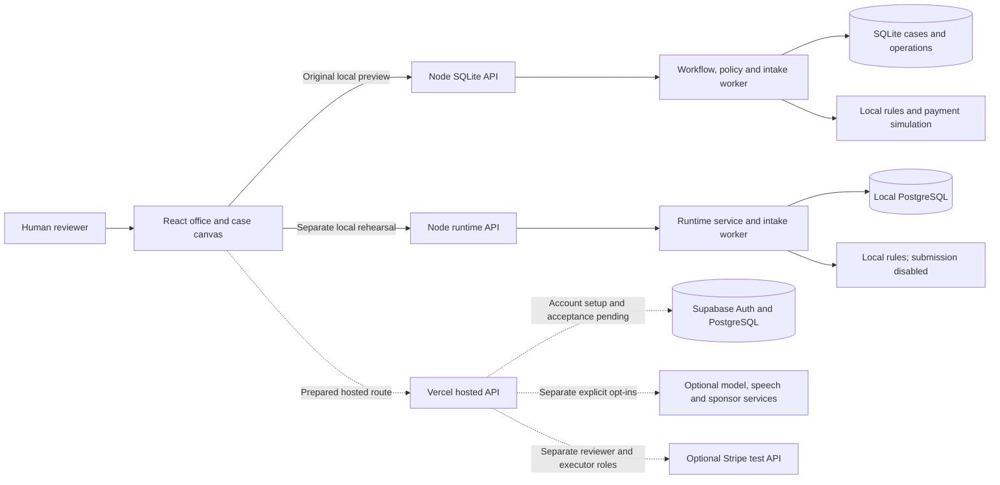
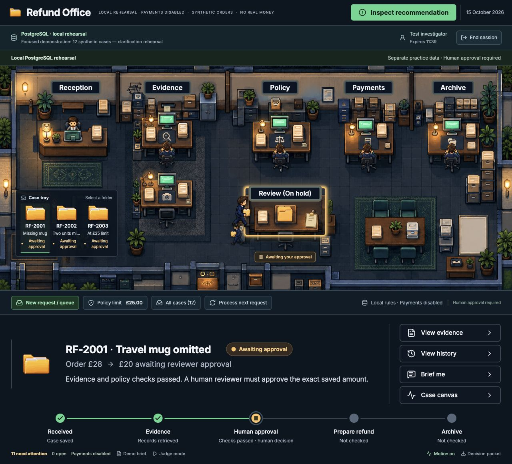
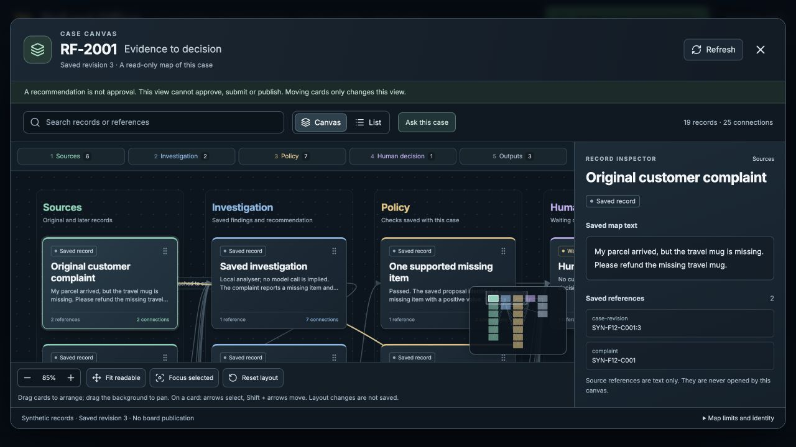
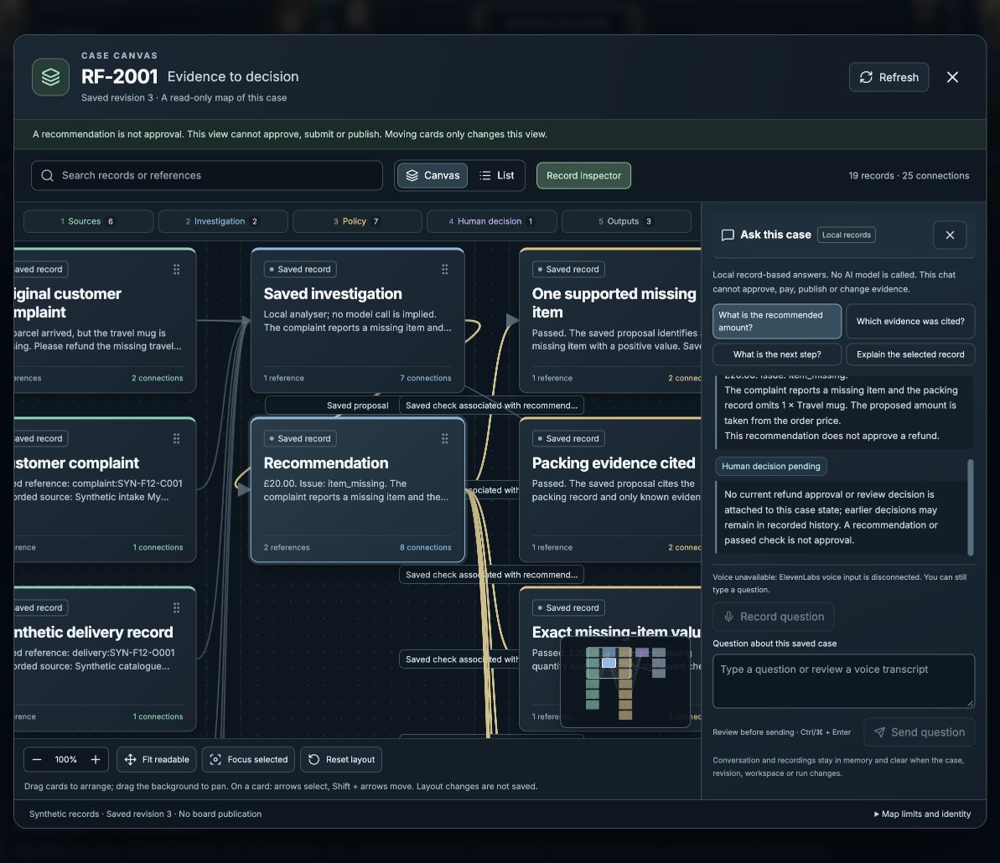
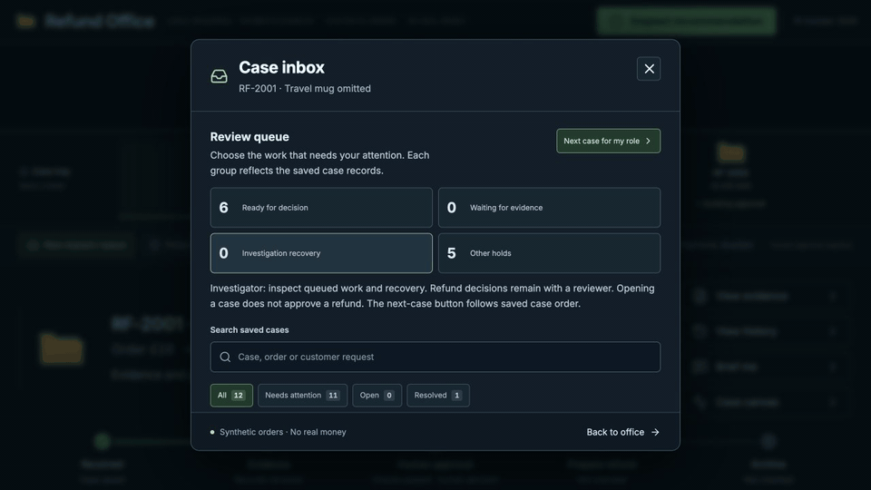
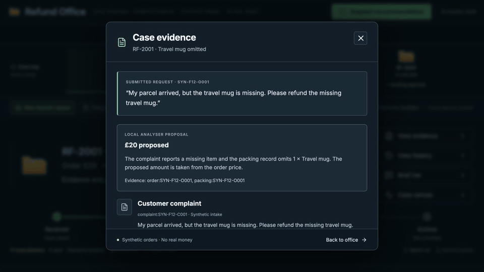
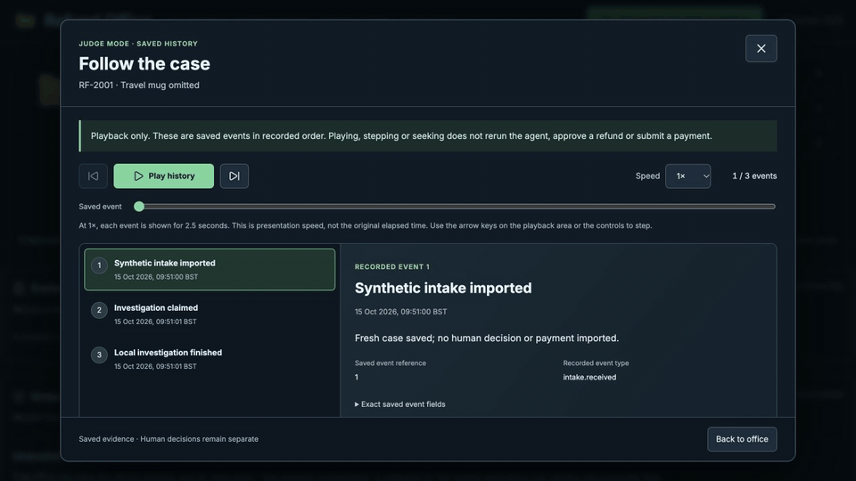
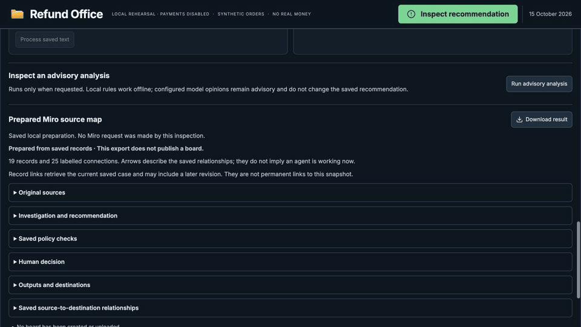
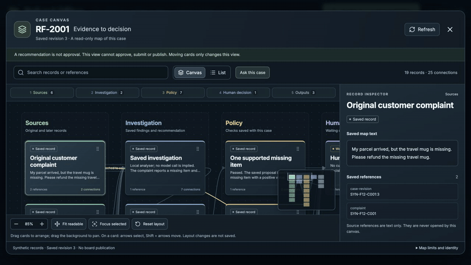

# Refund Office

The [judging plan](docs/JUDGING-PLAN.md) follows the six weighted criteria and gives a five-minute table demonstration. **Demo brief** presents the selected saved case, its output, evidence, analyser provenance and human decision boundary. The [Claude run guide](docs/CLAUDE-RUN-PROOF.md) covers the new bounded read-only tool investigator and three-case proof runner. Controlled checks are separate from the real Claude run, which still needs private key configuration and account acceptance.

Investigate a refund, inspect the evidence and approve the exact amount in a miniature office.

## Description

Refund Office is a local demonstration of a missing-item refund workflow for small retailers, developers and hackathon judges. It gathers supplied order, packing and delivery records, saves a recommendation, checks policy and waits for a person to decide. The pixel-art office shows the workflow stages; the decision brief preserves the evidence and history behind the result.

All supplied cases are synthetic. Ordinary previews use local rules, and every new refund requires explicit human approval. The original SQLite demo includes a local payment simulator; the separate PostgreSQL rehearsals keep payment submission disabled. Local test results do not establish real payment movement, provider acceptance or production readiness.

An initial private Vercel and Supabase deployment has been authorised, using a fresh synthetic workspace, local analysis and disabled payment execution. Hosted sign-in, membership restrictions, persistence and API routing still need account acceptance checks; no usable hosted deployment or public live URL has been verified. Other provider connections and Arize uploads remain disabled.

The [initial cloud database setup](docs/verification-initial-cloud-setup-2026-10-15.md) now records the actual Supabase schema, twelve-case synthetic import and owner reviewer membership. Hosted sign-in, investigator setup and Vercel deployment remain unfinished; the existing local previews continue separately.

## Table of contents

- [Description](#description)
- [Features](#features)
- [Tech stack](#tech-stack)
- [Architecture overview](#architecture-overview)
- [Installation](#installation)
- [Usage](#usage)
- [Configuration](#configuration)
- [Screenshots / demo](#screenshots--demo)
- [API / CLI reference](#api--cli-reference)
- [Tests](#tests)
- [Roadmap](#roadmap)
- [Contributing](#contributing)
- [Licence](#licence)
- [Contact / support](#contact--support)

## Features

- Investigate missing-item claims against supplied records and apply deterministic amount, policy and duplicate-remedy checks.
- Review the exact item, amount, evidence and policy result before approving. Save the reason, reviewer and case history; changed facts require fresh review.
- Request evidence, close without a refund, reopen with a reason and inspect uncertain payment results through their saved operation.
- Save a stable intake event and let the local worker investigate in the background. Replayed events return the saved case; the worker stops before approval or payment. The hosted queue requires a separately authorised investigator invocation and does not claim automatic processing when its worker is disabled.
- Search the inbox, use role-specific queues and download a decision packet, Markdown report or saved-evidence briefing.
- In clarification-enabled PostgreSQL rehearsals, record a received customer statement against an existing order item, investigate again and return to human review. Prepare an unsent clarification question from saved records.
- Explore saved provenance in the additional **Case canvas**, with pan, zoom, search, an accessible list and a record inspector. Moving a card changes its temporary layout only.
- Use **Ask this case** for local answers quoting saved map records. Citations select real cards. The separately gated ElevenLabs voice-input path drafts an editable question after an explicit transcription action.
- Rehearse with separate 12-case and 50-case synthetic packs. Reset-enabled rehearsals retain the earlier run and open a fresh copy of the same pack.
- Replay actual saved history in read-only **Judge mode**, and compare synthetic outcomes with committed expectations using local evaluation reports and recorded traces.
- Explore the workflow and prepared provider paths in the additional read-only **System map**, with separate Live/Still and Play story controls.
- Inspect prepared sponsor tools and source maps while their external actions remain disabled. The hosted preparation separates reviewer authorisation from a dedicated Stripe test executor.
- Follow desk activity and case handoffs, with optional motion and reduced-motion support.

A bounded Claude investigator and a read-only Demo brief are implemented and [checked separately](docs/verification-judging-2026-10-15.md). They are outside the earlier chat-and-voice checkpoint and its enclosed run proof; no successful real Claude execution is claimed.

The miniature office remains the main screen. Canvas, chat, System map, playback and downloads cannot approve a refund, alter evidence, contact a customer or publish a Miro board. The [review-workflow guide](docs/REVIEW-WORKFLOW.md), [canvas guide](docs/CASE-CANVAS.md) and [voice-input guide](docs/CANVAS-VOICE-INPUT.md) describe their controls and limits.

## Tech stack

| Area | Technology |
| --- | --- |
| Interface | React 19.2.0, JavaScript, CSS, Lucide icons and locally bundled Inter |
| Development and build | Vite 6.4.2 and the React Vite plugin |
| API and workflow | Node.js `node:http`, ES modules, deterministic rules and a local intake worker |
| Original persistence | SQLite through `node:sqlite` |
| Separate working-store rehearsal | Local PostgreSQL 16, isolated through Docker |
| Prepared hosted path | Vercel API routing, Supabase Auth and PostgreSQL migrations |
| Optional service adapters | OpenAI, Anthropic, ElevenLabs, n8n, Miro, Modal, Stripe and Port; external actions disabled in ordinary previews |
| Observability | Local operation traces and synthetic evaluations; Arize AX exporter disabled |
| Tests | Node.js built-in test runner and assertions |
| Architecture maps | Archify standalone HTML and editable typed JSON |

Local verification records use Node.js 26.10.0. The project does not declare an `engines` range; other complete runtime combinations have not been established.

## Architecture overview



The React interface calls one selected API; the SQLite demo, local PostgreSQL rehearsal and prepared hosted path have separate storage and access contracts. Investigation saves its evidence and checks, then stops for a human decision; payment authority is enforced in the service and database rather than granted by a policy pass. Dashed connections describe prepared external paths, not verified provider activity.

| Path | Current scope |
| --- | --- |
| Original SQLite, 4173/4174 | Local single-user demo, durable case history and local payment simulation |
| PostgreSQL office, 4273/4274 | Local test sessions, reviewer/investigator roles, background investigation and unpaid approval reservations |
| Clarification and Judge rehearsals | Separate retained runs with customer clarification, reports, recovery, reset and saved-history playback; providers and payment submission disabled |
| Prepared hosted application | Supabase sessions and tenant checks, protected n8n intake, sponsor action ledger and separately gated Stripe test execution; hosted acceptance pending |

The [architecture document](ARCHITECTURE.md) explains the boundaries and data model. Explore the [current sponsor runtime map](docs/diagrams/sponsor-runtime.html), [local observability map](docs/diagrams/local-observability.html) or [original SQLite map](docs/diagrams/refund-office.html); the last is the preserved 13 October snapshot.

The prepared hosted investigator can select OpenAI or Anthropic, with independent application and database checks. Its saved-case tools prepare ElevenLabs briefing playback, Miro publishing and readback, Modal text processing and Port publishing and readback. Actions bind to saved revisions and a durable ledger. A recorded provider result or authorised member's attestation is a workflow record, not independent proof of a provider action. See the [integration guide](docs/integrations.md), [hosted setup guide](docs/HOSTED-SETUP.md) and [payment execution contract](integrations/supabase/runtime/PAYMENT-EXECUTION.md).

## Installation

The original SQLite demo needs Node.js 26.10.0 and npm, with no separate database server or provider account. The PostgreSQL rehearsal also needs a running local Docker daemon and a cached `postgres:16-alpine` image; its launchers do not pull images. See [rehearsal prerequisites](docs/DEMO-REHEARSAL.md#prerequisites-and-isolation) before using that path.

1. Clone the [private GitHub repository](https://github.com/MasteraSnackin/refund-office) using an account with access:

   ```sh
   git clone https://github.com/MasteraSnackin/refund-office.git
   ```

2. Install the locked dependencies:

   ```sh
   cd refund-office
   node --version
   npm ci
   ```

3. Start the interface and API:

   ```sh
   npm run dev
   ```

4. Open <http://127.0.0.1:4173/>. The API listens on `127.0.0.1:4174`, and Vite forwards `/api` requests to it. Keep both processes running; `Ctrl+C` stops the combined launcher.

External requests stay disabled unless `REFUND_OFFICE_NETWORK` is exactly `enabled`. The normal launcher strips provider credentials from the offline API environment and the browser process. It does not automatically load a project `.env` file; [.env.example](.env.example) documents the settings.

## Usage

### Investigate a supplied claim

1. Select a case folder, or choose **New case**, select a supplied order and describe the complaint.
2. Choose **Run investigation**. Inspect **View evidence** and the **Policy** desk.
3. A supported new refund stops at **Awaiting approval**. Open **Review £X refund**, check the evidence and exact amount, enter a reason and approve that decision.
4. Read **View history** or download the **Decision packet**. Investigating an already remedied issue should show the existing remedy rather than create another refund.

On a fresh SQLite database, `DEMO-108` supplies a missing £18 desk mat; `RF-105` demonstrates conflicting delivery evidence and stays in Review. Reusing a database retains earlier decisions. The default £25 limit is an additional constraint: changed evidence, proposals, policy or provider selection require renewed investigation and approval. The [operating guide](docs/OPERATIONS.md) covers pause/resume, evidence holds, explicit reopening and uncertain-result recovery.

For an isolated practice database using the original catalogue, stop the current launcher and choose a new unused filename:

```sh
DB_PATH=.data/practice-01.sqlite npm run dev
```

Reusing that filename resumes its saved state. It does not reset remote Stripe test payments.

### Rehearse a queue without external services

| Pack | Command | Expected result after initial investigation, before new approvals |
| --- | --- | --- |
| Focused, 12 cases | `npm run demo:focused` | 6 awaiting approval, 5 held, 1 historical remedy |
| Busy office, 50 cases | `npm run demo:busy` | 26 awaiting approval, 20 held, 4 historical remedies |

These SQLite launchers force offline mode and store each pack separately under `.data/demo-packs/`. `npm run demo:prepare` prepares both databases without starting investigation. Reopening a pack keeps its decisions; add `-- --fresh` to create another isolated copy. The [synthetic pack guide](demo-data/README.md), [scenario guide](demo-data/SCENARIOS.md) and [desktop launchers](launchers/) describe the supplied cases and presentation path. Stop the current preview before switching; launchers refuse occupied ports.

For the current PostgreSQL demonstration, follow the [three-minute rehearsal guide](docs/DEMO-REHEARSAL.md). With its prerequisites available, start a separate run:

```sh
node scripts/run-judge-rehearsal.mjs focused-12 --ports 4773 4774
```

Open <http://localhost:4773/> and select **Local reviewer**, an explicitly labelled test identity. The guide covers stable intake, a fictional received clarification, fresh review, a saved decision brief, Judge mode and resetting the same pack. Reset retains the earlier volume and decisions; use the latest confirmed restart command to reopen a saved run. Local profiles do not demonstrate real hosted sign-in.

### Inspect saved evidence and outputs

Use **Intake queue** to submit a complaint with a stable event reference. The worker can continue while another case is selected, but cannot approve, submit or reconcile a refund. Read the saved briefing, download the Markdown report or inspect the prepared source map. Reports distinguish a recommendation, approval reservation, unresolved operation and confirmed local receipt; earlier review history remains visible after clarification.

Open **Case canvas** to follow Sources, Investigation, Policy, Human decision and Outputs. Search, select a card, use the list or move cards to inspect relationships. **Ask this case** answers from the verified saved map without a model call. Its conversation and pending microphone data clear when the case, revision, workspace, run or principal changes, or the panel closes.

The prepared voice path is served by the session-scoped PostgreSQL and hosted APIs, not the original SQLite API. It requires separate configuration and account checks: record locally, explicitly choose **Transcribe with ElevenLabs**, edit the returned question and choose **Send question**. Transcription does not add evidence or send the question automatically. The [voice guide](docs/CANVAS-VOICE-INPUT.md) explains upload consent, limits and provider-retention unknowns; speech input is separate from saved-briefing playback.

**Inspect prepared map** shows saved provenance for Miro without publishing a board. Its JSON is a custom preparation format; direct Miro import is unverified. Map arrows describe saved relationships, source references remain text, and record downloads retrieve the current authenticated case rather than promise a permanent revision snapshot. Available output links do not establish delivery or payment. See the [canvas guide](docs/CASE-CANVAS.md) and [Miro verification](docs/verification-miro-provenance-2026-10-14.md).

Open **System map** beside Demo brief and Judge mode to explore the [authored architecture](docs/diagrams/sponsor-runtime.html). It is labelled **Illustrated architecture, not live traffic**. The embedded map starts Still; choose **Live**, then **Play story** for the guided tour, or **Still** to pause. Its controls are separate from office motion and respect reduced-motion preferences. The isolated iframe receives no case records or application actions, and its sandbox and Content Security Policy restrict access and connections. Opening the map does not investigate, approve or submit a payment.

The chosen architecture-map destinations are this additional app view, the pitch presentation and a separate 30-second video. Saved-case evidence and provider execution proof remain separate from the illustrated flow. Native PowerPoint playback remains unverified; the [animated system map verification record](docs/verification-animated-system-map-2026-10-15.md) records the artifacts and checks for each destination.

Other procedures are documented in the [local PostgreSQL guide](docs/LOCAL-POSTGRES-OFFICE.md), [review-workflow guide](docs/REVIEW-WORKFLOW.md) and [five-improvement guide](docs/FIVE-IMPROVEMENTS.md). They cover role queues, unsent customer questions, bounded clarification, safe failure continuation, Judge playback and current-runtime evaluation. The separate hosted payment review records permission for a dedicated executor; ordinary PostgreSQL previews show it as unavailable.

## Configuration

| Setting | Default or purpose |
| --- | --- |
| `DB_PATH` | `.data/refund-office.sqlite`, relative to the working directory |
| Refund policy limit | `2500` pence (£25), saved with its version; change through the UI or API |
| `REFUND_OFFICE_NETWORK` | Unset or `offline` disables external requests; exactly `enabled` opts in |
| `REFUND_OFFICE_ANALYSER` | `local`; `openai` or `anthropic` requires explicit network opt-in and that provider's credentials |
| `REFUND_OFFICE_ENABLED_INTEGRATIONS` | Empty in ordinary previews; prepared runtime actions also require the individual integration name |
| `REFUND_OFFICE_CHALLENGER` | `none`; an optional Anthropic advisory comparison requires a different primary analyser |
| `OPENAI_API_KEY`, `OPENAI_MODEL` | Optional model configuration; existing OpenAI default is `gpt-4o-mini` |
| `ANTHROPIC_API_KEY`, `ANTHROPIC_MODEL` | Required when Anthropic is explicitly selected; no model is assumed |
| `ELEVENLABS_API_KEY`, `ELEVENLABS_VOICE_ID`, `ELEVENLABS_MODEL` | Prepared saved-briefing speech requires an approved voice; existing model default is `eleven_multilingual_v2`, with account availability unverified |
| `REFUND_OFFICE_VOICE_INPUT` | Exactly `elevenlabs`, plus the separate `elevenlabs-transcription` allowlist entry, enables the prepared speech-input path only after other prerequisites |
| `ELEVENLABS_STT_ENABLE_LOGGING` | Optional transcription-retention request; account eligibility and actual retention need provider verification |
| `STRIPE_SECRET_KEY` or `STRIPE_API_KEY` | Optional test key after explicit opt-in; `STRIPE_SECRET_KEY` takes precedence |
| `API_PORT` | `4174`; changing it alone is unsupported because proxy and origin settings also use the fixed ports |

Only after network opt-in does `npm run dev` read optional `sandbox.env` and `model.env` files from the user's Refund Office configuration directory. Existing non-empty process values take precedence. `dev:api` reads only its process environment. Ambient credentials do not select an external analyser, and rehearsal launchers force local analysis and disabled external connections.

Keep keys in server secret storage, outside browser code and shared files; never use `VITE_` secret variables. No provider account is needed for the local workflow. See the [safe environment template](.env.example), [integration setup](integrations/SETUP.md), [online setup guide](docs/ONLINE-SETUP.md) and [hosted setup](docs/HOSTED-SETUP.md) for full contracts. Configuring an adapter does not establish successful account access, and provider failures do not silently become local successes.

Preparation covers ten sponsor roles: OpenAI, Anthropic, ElevenLabs, n8n, Supabase, Vercel, Miro, Modal, Stripe and Port. Arize AX is additional observability. The [Supabase runtime guide](docs/SUPABASE-RUNTIME.md) and [migration plan](docs/SUPABASE-MIGRATION.md) describe the additive migrations and controlled cutover. The [sponsor preparation archive](ARTIFACTS.md#excluded-12ca650e4f4df768) is an earlier source/example package, not the full current application or a deployment. The earlier canvas-only deployment staging is retained as a historical snapshot. The [newer combined-assistant preparation](ARTIFACTS.md#excluded-d808bf27c8e2f922) includes the chat and transcription modules, with its own source-hash, build and disconnected-handler checks. Match that snapshot to the intended source before deployment; local preparation does not verify hosting.

## Screenshots / demo



The miniature office is the main screen. This local synthetic case shows the investigation stages and saved case details.



The additional **Case canvas** presents saved evidence, investigation, checks, human decisions and outputs. It is a read-only view of those records; moving cards changes only their temporary layout and does not publish a Miro board.



The optional **Ask this case** panel answers from local saved records without a model call. Its citations select the corresponding canvas cards. These screenshots do not establish live provider activity, payment movement or a hosted deployment.

### Animated application screens

These short recordings show the local synthetic application on 15 October 2026. They use actual browser frames and recorded timing. The captures inspect saved records without changing evidence, approving refunds or contacting providers. The GIFs play in GitHub's README view. Open the [screen gallery](docs/ANIMATED-SCREENS.html) from a local clone for videos with play and pause controls; each recording also has a still-image alternative.

**Review queue.** Filter cases by their next step, distinguish recommendations from holds, and search the saved list.



[Play video](docs/images/animated/refund-office-review-queue.mp4) · [View still image](docs/images/animated/refund-office-review-queue.jpg)

**Evidence inspection.** Read the complaint and recommendation, then compare the supplied order with its packing quantities and prices.



[Play video](docs/images/animated/refund-office-evidence.mp4) · [View still image](docs/images/animated/refund-office-evidence.jpg)

**Saved investigation replay.** Follow the actual intake, investigation claim and saved result in recorded order. Judge mode presents each event for 2.5 seconds at 1×; this is playback of saved events, not a new investigation or its original elapsed time.



[Play video](docs/images/animated/refund-office-history.mp4) · [View still image](docs/images/animated/refund-office-history.jpg)

**Prepared Miro source map.** Expand saved sources and labelled connections to see where information came from and how the case used it. This is local preparation; no Miro board is published.



[Play video](docs/images/animated/refund-office-miro-map.mp4) · [View still image](docs/images/animated/refund-office-miro-map.jpg)

**Case canvas navigation.** Move through Investigation, Policy, Human decision and Outputs while the inspector shows the selected saved record. The human decision remains pending.



[Play video](docs/images/animated/refund-office-case-canvas.mp4) · [View still image](docs/images/animated/refund-office-case-canvas.jpg)

The [three-minute SQLite film](docs/demo/refund-office-3min.mp4) shows synthetic cases in the original demo. It predates the intake panel and sponsor preparation added on 14 October. [English subtitles](docs/demo/refund-office.en-GB.srt) are available. The [saved-case tools image](docs/diagrams/sponsor-case-tools.png) shows a later local advisory result with external actions disabled.

Later one-minute and three-minute fallback films show PostgreSQL intake, clarification, the decision brief and a prepared Miro map. Their evaluation footage uses the earlier SQLite engine, and they predate Judge mode, broader language checks and current PostgreSQL evaluation. The [recording guide](docs/DEMO-REHEARSAL.md#recordings-and-version-boundaries) identifies those files and their scope. No current combined-release recording or verified live deployment URL is available.

The local application is <http://127.0.0.1:4173/> while `npm run dev` is running. The Sites build packages the interface only; its asset-serving worker does not run the refund API or SQLite workflow.

## API / CLI reference

The original SQLite API is local and single-user. Ordinary mutations require a JSON object with `Content-Type: application/json` and a 16 KiB body limit; errors use `{ "error": { "code": "...", "message": "..." } }`. PostgreSQL and prepared hosted routes require a session, and mutations bind stable command identities. The voice-input route has its own bounded audio contract.

Read available cases without changing state:

```sh
curl --fail --silent http://127.0.0.1:4174/api/bootstrap
```

Download a seeded decision packet:

```sh
curl --fail --silent \
  http://127.0.0.1:4174/api/cases/missing-item/export \
  --output missing-item-decision-packet.json
```

API identifiers differ from display numbers. The seeded SQLite IDs are `missing-item`, `conflicting-evidence` and `repeat-request`; read the current case before sending a revision or approval fingerprint.

| Method and route | Purpose |
| --- | --- |
| `GET /api/bootstrap` | Cases, supplied orders, policy and capabilities |
| `POST /api/intake` | Save or replay an event with `eventId`, `orderId` and `complaint` |
| `POST /api/cases/:id/run` | Start a manual investigation; successive `advance` requests move it through stages |
| `POST /api/cases/:id/review` | Request evidence, close without a refund or reopen, with the expected revision and a reason |
| `POST /api/cases/:id/approve` | Approve the exact revision, amount and fingerprint with a note |
| `POST /api/cases/:id/reconcile` | Inspect an unresolved submitted operation |
| `GET /api/cases/:id/export` | Download the saved decision packet |
| `GET /api/cases/:id/briefing` | Read the saved text briefing |
| `GET /api/cases/:id/report` | Download the Markdown report |
| `GET /api/cases/:id/board-export` | Read the prepared provenance map for the saved case |
| `GET /api/cases/:id/customer-draft` | Read an unsent clarification question in PostgreSQL and hosted workspaces |
| `PATCH /api/policy` | Set an integer `limitMinor` from `0` to `100000` |

The original SQLite approval reserves an operation; a later reviewer-driven `advance` submits it. Intake workers cannot perform that payment step. The [operating guide](docs/OPERATIONS.md), [PostgreSQL guide](docs/LOCAL-POSTGRES-OFFICE.md), [hosted guide](docs/HOSTED-SETUP.md) and [voice contract](docs/CANVAS-VOICE-INPUT.md#request-and-access-boundaries) cover the remaining routes and distinct access rules.

| Command | Purpose |
| --- | --- |
| `npm run dev` | Start the original UI and SQLite API |
| `npm run dev:api` | Start the original API only |
| `npm run dev:ui -- --port 4173 --strictPort` | Start the UI separately on its supported port |
| `npm run build` | Build the UI and static Sites package |
| `npm run preview` | Preview the built UI; does not start the refund API |
| `npm run demo:runtime` | Start the separate focused PostgreSQL office on 4273/4274 |
| `npm run demo:judge` | Start a separate offline Judge rehearsal on 4673/4674 |
| `npm run evaluate:local` | Evaluate both synthetic packs through the original SQLite engine in fresh in-memory stores |
| `npm run evaluate:runtime` | Evaluate the current service in a fresh local PostgreSQL database |
| `npm run handover:prepare` | Assemble allowlisted source and synthetic examples without uploading |

Evaluation reports link observed outcomes to actual local traces. They create no refund approvals or payments, and do not upload to Arize. See the [current-runtime evaluation guide](docs/FIVE-IMPROVEMENTS.md#evaluate-the-current-postgresql-application) and [Arize guide](integrations/arize/README.md) for artifacts, excluded customer data, bounded trace collection and exporter controls. Development and migration-check commands are listed in the linked setup guides and [package.json](package.json).

## Tests

The suite uses Node.js's built-in test runner. Build first because the Sites tests inspect generated files:

```sh
npm run build
npm test
npm run test:sites
```

Coverage includes workflow transitions, intake replay, approval and duplicate-payment boundaries, isolated persistence, error recovery, saved outputs, case controls, mocked provider contracts and static packaging. PostgreSQL integration checks require the local Docker prerequisites and create isolated test databases; see the [runtime guide](docs/SUPABASE-RUNTIME.md) and [local office guide](docs/LOCAL-POSTGRES-OFFICE.md).

Verification records describe the code version and scope checked at each stage: [review workflow](docs/verification-review-workflow-2026-10-15.md), [canvas checkpoint](docs/verification-case-canvas-2026-10-15.md), [five improvements](docs/verification-five-improvements-2026-10-14.md), [reset/report reliability](docs/verification-demo-reliability-2026-10-14.md), [customer clarification](docs/verification-evidence-loop-2026-10-14.md), [payment review](docs/verification-payment-review-2026-10-14.md), [sponsor wiring](docs/verification-sponsor-wiring-2026-10-14.md) and [original local office](docs/verification-local-office-2026-10-14.md). The [documentation verification](docs/verification-documentation-2026-10-15.md) covers this README and architecture refresh. These are records of completed checks, not a claim that the full suite was rerun for this documentation change.

Provider tests use fake values and controlled responses. Local fixtures do not establish hosted membership, provider account access, microphone behaviour, real transcription quality, payment movement or production readiness. The [combined chat and voice verification](docs/verification-canvas-chat-voice-2026-10-15.md) records 761 passing application tests, the local browser rehearsal and restart readback. The [voice guide](docs/CANVAS-VOICE-INPUT.md#verification-status) retains the unverified microphone, provider-retention and live-transcription limits; the earlier canvas-only checkpoint does not cover those additions.

The build creates `dist/client/index.html`, `dist/server/index.js` and `dist/.openai/hosting.json`. That server bundle serves assets; it is separate from the refund API. Earlier interface observations are in [design-qa.md](design-qa.md).

## Roadmap

- Match the checked combined source package to the intended release, complete the authorised private Vercel/Supabase setup, then check sign-in, workspace membership, persistence and API routing with synthetic data.
- Run separate acceptance checks for any explicitly enabled provider, including voice input and the prepared payment executor.
- Establish hosted monitoring, backup/restore and recovery procedures.
- Validate the retailer problem and reviewer workflow using the [business-validation kit](docs/business-validation/README.md). No customer results or time savings have been measured.
- Consider evidence uploads and explicit customer-message delivery; neither is implemented in the current workflow.

## Contributing

Use a separate local copy and synthetic data. Explain the affected workflow, preserve explicit human approval before every refund, and run the build and relevant tests. Keep credentials, database files and customer data out of shared source.

Preserve the packaging files named in [AGENTS.md](AGENTS.md). UI changes should retain the selected office artwork, clear evidence and history panels, optional motion and reduced-motion behaviour.

The [GitHub repository](https://github.com/MasteraSnackin/refund-office) is private. Contributors with access can open issues and pull requests there.

## Licence

The application has no declared licence or project-level `LICENSE` file. Dependency licences do not establish the licence for this project.

Project licence: `<ADD LICENCE TYPE AND LICENSE FILE>`.

## Contact / support

Use the private repository's [issue tracker](https://github.com/MasteraSnackin/refund-office/issues) for project questions and problems. No public support channel has been supplied.

When reporting a problem, include the command or UI action, Node.js version, error text and whether the providers were local or external. Remove credentials and personal data from shared packets and logs.
