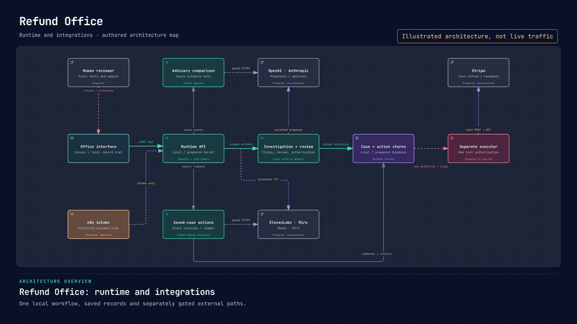

# Refund Office

Refund Office prepares missing-item refund decisions for small retailers. It gathers the evidence, checks policy and recommends an exact amount. A person decides whether to approve it.

[Architecture](ARCHITECTURE.md) · [Operating guide](docs/OPERATIONS.md) · [Hosted preview](https://refund-office.vercel.app)

The supplied cases are synthetic. Local demos use rules rather than a live model, and every new refund requires human approval. The hosted preview currently presents a protected sign-in screen; authenticated workflow acceptance is still pending.

### Three-minute product demo

https://github.com/user-attachments/assets/7a14798b-90b8-4f99-991c-2730d703eeab

[Watch or download the three-minute demo](https://github.com/user-attachments/assets/7a14798b-90b8-4f99-991c-2730d703eeab) · [Captions (SRT)](docs/demo/refund-office-product-demo-3min.en-GB.srt)

*Recorded on 15 October 2026: synthetic local investigation, clarification, review, saved reports and Case canvas. Local rules power the run; no refund was approved or submitted. The closing scorecard is the earlier SQLite-engine evaluation.*

## What operational problem it solves

A support agent handling “my item is missing” must compare the complaint with the order, packing record, delivery status and previous refunds. They then need to calculate the right amount, apply the shop's policy and explain the decision.

Refund Office brings those checks into one case. It prepares the recommendation and supporting records, holds unclear claims for review and saves a downloadable decision brief. The miniature office shows each stage; the case canvas lets a reviewer follow the evidence into the recommendation. Reducing review effort is the product hypothesis; customer time savings have not been measured.


*Recorded local PostgreSQL rehearsal with synthetic data. No live AI call or payment is shown.* [Video](docs/images/animated/refund-office-review-queue.mp4) · [Still image](docs/images/animated/refund-office-review-queue.jpg)

## Architecture

The React/Vite interface calls a Node.js API. One investigation worker gathers saved records and prepares a proposal. Deterministic checks validate the amount, evidence references, policy limit, duplicates and remaining balance before handing the case to a human reviewer. Changed facts invalidate the earlier recommendation and require fresh review.

The quick local demo stores cases in SQLite and includes a payment simulator. The richer rehearsal uses PostgreSQL and records approval as an **unpaid reservation**. The hosted path uses Supabase Auth and PostgreSQL behind a Vercel API. Stripe test execution has a separate authorisation and executor; a recommendation or reservation cannot trigger it.

Click the animated Archify preview to explore the runtime and prepared integrations. The interactive map opens without sign-in.

[](https://refund-office.vercel.app/system-map.html)

[Open the interactive Archify map](https://refund-office.vercel.app/system-map.html) · [Payment authority view](https://refund-office.vercel.app/system-map.html#view=payment-boundary) · [Still image](docs/images/animated/refund-office-architecture.jpg) · [Full architecture and data model](ARCHITECTURE.md)

Choose **Live → Play story** for a guided tour, or use search, focus and route tracing. **Still** stops motion. This is illustrated architecture, not live traffic; a drawn provider connection does not establish an active integration.

The [editable runtime map](docs/diagrams/sponsor-runtime.architecture.json) and [smaller source-linked overview](docs/diagrams/readme-overview.sources.md) are included for technical review.


*The canvas reads saved records; moving cards changes only the view.* [Video](docs/images/animated/refund-office-case-canvas.mp4) · [Still image](docs/images/animated/refund-office-case-canvas.jpg)

## How to run it

Use Node.js **26.10.0**, the version used for local checks, and npm. The quick demo needs no provider account or separate database server.

```sh
git clone https://github.com/MasteraSnackin/refund-office.git
cd refund-office
npm ci
npm run dev
```

Open **http://127.0.0.1:4173/**. The launcher also starts the API on port `4174`; stop both with `Ctrl+C`. Select a supplied case, run its investigation, inspect the evidence and make the review decision. Provider connections are disabled by default.

For the richer rehearsal shown in the GIFs, start Docker and have `postgres:16-alpine` cached locally, then run:

```sh
npm run demo:judge
```

Open **http://localhost:4673/** and choose a local test profile. This mode adds the role queue, clarification, saved-history replay and retained demo reset. Its launcher does not pull Docker images or connect providers. See the [rehearsal guide](docs/DEMO-REHEARSAL.md) for prerequisites and saved-run handling.

To check the source, build first because the Sites tests inspect generated assets:

```sh
npm run build
npm test
```

Configuration is documented in [.env.example](.env.example) and the [integration guide](docs/integrations.md). The template is not loaded automatically. Keep credentials server-side; a saved key alone does not enable a service. `npm run preview` serves the built interface only, without the refund API.

## Models, APIs and external services used

**The default local run makes no model or external-service calls.** It uses local rules, SQLite or local PostgreSQL, and saved synthetic evidence. Vercel and Supabase have an initial hosted setup; authenticated application checks remain open. Other integrations below are implemented adapters or setup files and still need explicit activation and account testing.

| Tool or service | Role and current scope |
| --- | --- |
| OpenAI | Optional Responses API investigation proposal. The code defaults to `gpt-4o-mini`; `OPENAI_MODEL` can override it. Disabled in ordinary demos. |
| Anthropic | Optional Messages API proposal, independent comparison and bounded Claude tool investigator. `ANTHROPIC_MODEL` must be selected explicitly. A successful real Claude run is not yet verified. |
| ElevenLabs | Optional saved-briefing speech (`eleven_multilingual_v2`) and separately consented transcription (`scribe_v2`). Voice selection and provider acceptance are still required. |
| Supabase | Hosted identity, workspace membership and PostgreSQL storage. The synthetic schema/import and owner membership are recorded; application sign-in and isolation checks remain open. |
| Vercel | Hosts the protected interface and API at the preview link above. A served sign-in page does not establish a completed refund workflow. |
| Stripe | Prepared test-refund submission and readback through a dedicated executor. Disabled in the current hosted setup and PostgreSQL rehearsals. |
| n8n | Prepared protected intake trigger and bounded investigation invocation. It does not currently schedule the hosted queue. |
| Miro | Prepared publishing of case sources, checks and outcomes as a board. The local map inspector works without publishing. |
| Modal | Prepared processing of supplied evidence text. Document upload and OCR are not implemented. |
| Port | Prepared publishing of service-readiness metadata. It receives no case contents. |
| Arize AX | Prepared trace/evaluation export. Local traces and synthetic scorecards work without uploading; AX uploads remain disabled. |

See [service configuration](integrations/SETUP.md), the [Claude investigator guide](docs/CLAUDE-RUN-PROOF.md) and the [Arize guide](integrations/arize/README.md) for contracts and verification scope. Model output cannot approve refunds or override deterministic checks.

## Key assumptions

- The prototype handles missing-item claims against a supplied synthetic catalogue and policy, with GBP amounts stored in integer pence.
- Order, price, packing and delivery records are authoritative. A received customer clarification may identify an item, but cannot rewrite those records or bypass a dispute.
- A reviewer checks the exact saved facts and amount. The approval binds to that version of the case; retries reuse stable commands rather than create another refund.
- Local reviewer/investigator profiles are fictional test identities. Real hosted access depends on Supabase authentication and workspace membership.

## Known limitations

- Synthetic results and controlled provider tests do not establish real-world accuracy, customer benefit, live model quality or money movement.
- Feature sets differ between the original SQLite simulator, local PostgreSQL rehearsals and hosted setup. The hosted workspace has no configured investigator identity, so its queued cases do not process automatically. Hosted Reset demo is unavailable.
- Authenticated hosted sign-in, role isolation, saved-data persistence and provider acceptance still need end-to-end checks. A separate no-login synthetic web demo is planned, not included in this source snapshot.
- Local language rules are narrow. Ambiguous or contradictory statements stay on hold. Evidence uploads, OCR and sending customer messages are not implemented; reply drafts remain unsent.
- The public source has no declared project licence. See the linked verification records before relying on any feature or deployment claim.

## What we'd build next

1. Complete hosted sign-in, role isolation, persistence and a bounded investigator invocation; keep the public synthetic demo separate from private records.
2. Verify a short real Claude investigation in the authorised hosted environment, then test other providers individually without weakening human approval.
3. Rehearse the separately authorised Stripe test-payment handoff, including uncertain responses, readback and duplicate prevention.
4. Test the workflow with a small retailer and measure review time and decision quality using the [business-validation kit](docs/business-validation/README.md).
5. Add sourced evidence uploads, reviewed customer-message delivery and operational backup/recovery once the core workflow is accepted.
