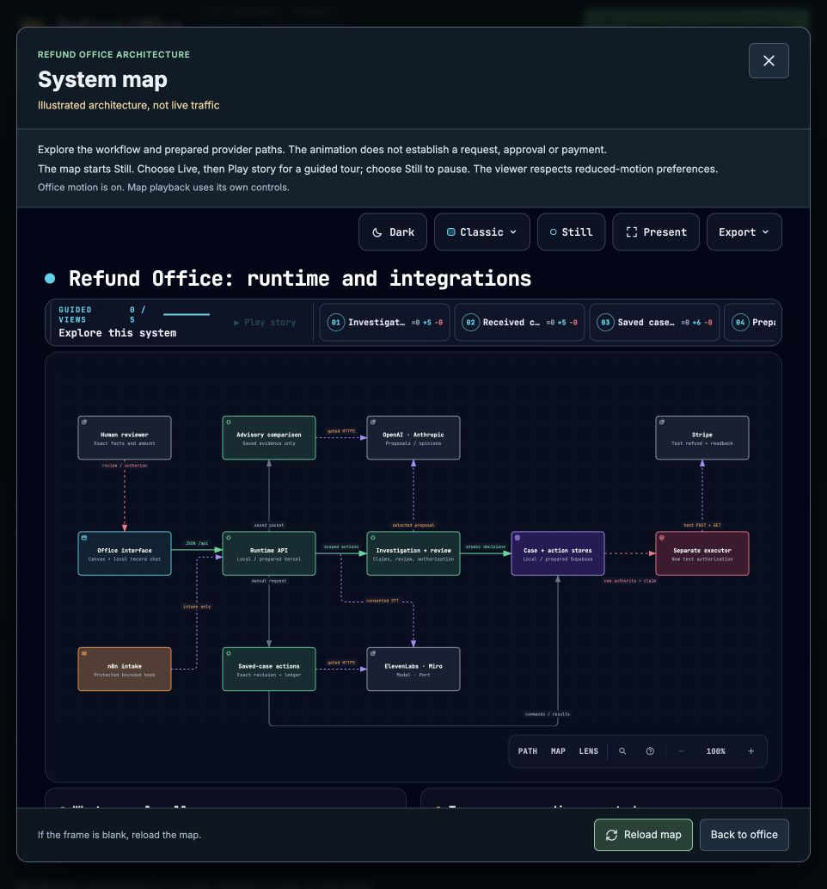

# Animated system map verification — 15 October 2026

The requested runtime and integrations map is now an additional Refund Office view, a separate 30-second animation and an extra pitch slide. These illustrate the authored architecture. They do not represent live traffic or establish a model call, approval, provider response or payment.

## App and canonical map

- Open the local office, then **System map** beside Demo brief and Judge mode. The embedded map starts **Still**. Choose **Live**, then **Play story**; choose **Still** to pause. Its five chapters cover investigation/review, clarification, saved-case tools, prepared intake and separate payment authority.
- The canonical [HTML](diagrams/sponsor-runtime.html), [editable JSON](diagrams/sponsor-runtime.architecture.json) and [delivery receipt](diagrams/sponsor-runtime.delivery.json) retain 12 components and 14 directed relationships. Only motion metadata and a short evidence-card explanation changed from the prior graph.
- The app uses `public/system-map.html`, prepared by `scripts/prepare-system-map.mjs` only after checking the canonical receipt, digest and nine-check validation. The derivative adds an early network-denying CSP, initial Still mode and a toolbar row for narrower frames. The exact transformation is tested and recorded in `work/animated-system-map-2026-10-15/public-asset.json`.
- The iframe grants `allow-scripts` only. It has no shared origin, form, popup or download permission. `connect-src 'none'` blocks provider requests. The React component receives no case, API or financial action props. No approval or payment control was added.

Archify deterministic validation and delivery passed all nine showcase checks, with zero errors or warnings. Its automated visual check passed containment, readability and viewer controls at 1440×900, 1600×1000, 1920×1080 and 2048×1320. The exact 1440 light and 2048 dark screenshots were inspected. The first attempt measured six pixels of vertical overflow at laptop size; shortening the evidence card fixed it without changing the graph. The final [review record](diagrams/sponsor-runtime.review.json) separates these checks from human inspection and interactions.

## Browser checks

BrowserOS was unavailable in this session, so the existing Codex in-app browser was used against the running local office. The actual embedded map loaded, started Still with story playback disabled, enabled playback after Live, progressed through the authored chapters and paused on Still. Reload returned to Still. Close and Back to office restored focus to the System map opener. Escape with parent-dialog focus closed the modal; Escape inside the isolated frame cleared the viewer's own focused chapter instead. Both exit buttons remain visible.

The narrower office-window toolbar was inspected after its overlap repair. The existing Case canvas still opened 19 saved records and 25 labelled connections for RF-2001 at revision 3; the recommendation inspector still showed £20 waiting for a reviewer. The investigator session expired during inspection and was re-entered as the same local test profile. No case was approved, reinvestigated, reset or submitted for payment. Browser media emulation turned office motion off and was then removed; the original office setting was restored. Propagation of that emulation into the opaque frame was not separately established, so this is not claimed as an end-to-end reduced-motion check of the iframe.

## Application checks

The production build passed. It contains the same public map bytes as the checked derivative. The full Node test suite passed **825 tests**, with zero failures or skipped tests. This total includes concurrent application work and is a software checkpoint, not a count of agent runs or provider tests.

Focused System map coverage checks sandbox/CSP, receipt freshness, exact transformation, initial Still mode, loading/retry generations, stale callbacks, dialog focus, overlay exclusivity, case changes and the absence of financial/action props. An independent read-only source review found no concrete regression or authority issue. Logs are retained under `work/animated-system-map-2026-10-15/`.

## Video

The [standalone MP4](../ARTIFACTS.md#excluded-e6ad850e07c6cfcb) is exactly 30 seconds, 1920×1080, H.264, 30 fps and 900 frames, with no audio stream. It is silent because this request concerned animating the existing map; no new narration provider was contacted.

The composition reuses the canonical SVG. The full-HTML card edit left that SVG byte-identical. All component and relationship identifiers, labels and directions are retained; a geometry check matched all 14 connector endpoints to their declared node boundaries. Camera moves focus the local route, human authority, optional tools and separate executor. The label **Illustrated architecture, not live traffic** stays visible throughout.

HyperFrames lint/runtime/layout/motion/contrast checks completed with zero errors. Known warnings concern single-composition organisation and native SVG anchor detection; the independent endpoint check addresses the latter. Full FFmpeg decoding passed, and nine decoded frames were inspected in the [contact sheet](../ARTIFACTS.md#excluded-1e647ea8d590f761). This is sampled visual inspection, not a claim of continuous viewing in a native media player. The [delivery record](../ARTIFACTS.md#excluded-5ccb5c75fd1e6fe9) and editable video folder retain provenance and media metadata.

MP4 SHA-256: `cb6744fa264f9fda14fd16a03db2df21adbccc8ea3d18fc7fc5b3622af9f2807`.

## Pitch and handover

The updated pitch retains the original six-slide story and adds a seventh architecture slide with the actual MP4 embedded. Speaker notes allow approximately 150 seconds for speech and 30 seconds for playback. The PDF is a static poster version and cannot animate. Native PowerPoint playback remains unverified; the standalone MP4 is included as a fallback.

The new additive package is `deliverables/hackathon-submission-animated-2026-10-15/`. Its manifest and archive verification record identify the final deck, PDF, MP4, map, submission answers and unchanged proof-of-run package. The architecture animation is separate from the actual recorded run. Previous pitch versions and the original submission archive are retained.

No deployment, provider activation, upload or financial operation was performed for this feature. The authorised owner-only hosting setup still needs its own account and acceptance checks.
