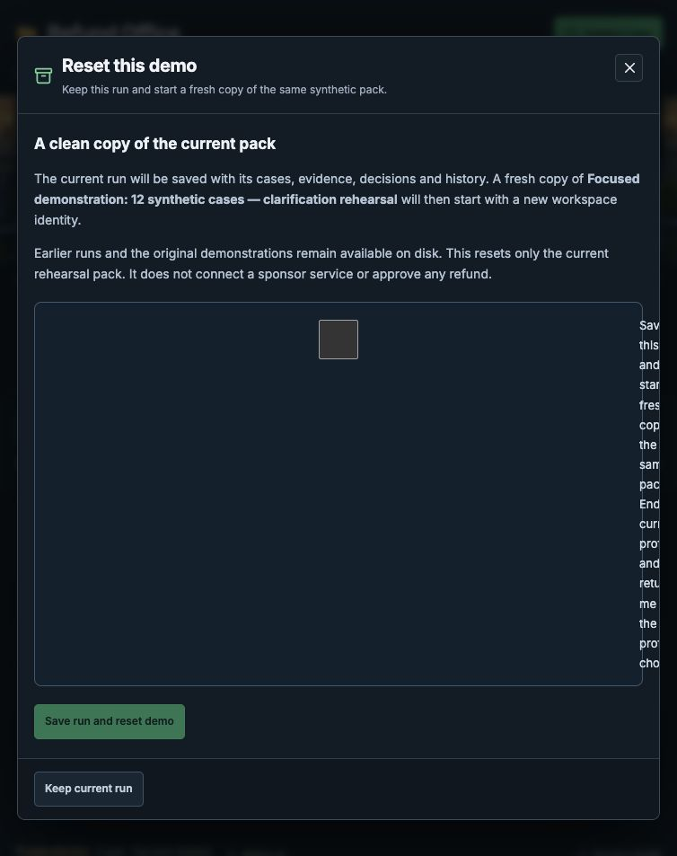
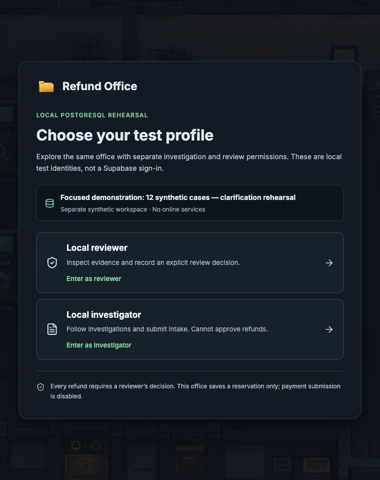

# Demo reset verification, 14 October 2026

Status: implemented and checked locally. External services remain disconnected.

Reset demo starts a fresh copy of the current synthetic pack. The prior run, its evidence and its decisions remain saved separately. It must not delete or reseed existing cases, authorise a refund or enable a sponsor connection.

The [customer clarification verification](verification-evidence-loop-2026-10-14.md) remains a completed historical record of the previous stage.

Checks completed:

- All 424 application tests passed, including 13 reset controller/API checks and 21 reset/download interface checks. Coverage includes persisted intent before effects, exact replay, interrupted startup refusal, checkpoint and startup failures, role restrictions, run identity checks, draining accepted requests and stale downloads.
- The build and all four Sites packaging checks passed. This is local build evidence, not a hosted deployment.
- Six lifecycle checks passed against real, isolated PostgreSQL volumes. The source run contained a fictional clarification; reset started exactly one fresh target, revoked the old session and rejected stale requests. Explicitly restoring the source recovered all twelve cases, their clarification history and the checkpoint exactly. The fresh target had zero approvals and no new payment; the single seeded historical operation remained labelled. Both disposable test volumes were removed after ownership checks.
- Before switching previews, both existing twelve-case PostgreSQL runs matched their saved cases, orders, policy and intake snapshots exactly.
- The fifteen original data files and four earlier preparation archives matched their saved hashes.

## Browser rehearsal

The existing clarification run, including the unapproved £10 sketchbook recommendation, was gracefully checkpointed and retained. A separate fresh rehearsal exercised the reset button; that did not reset the retained sketchbook run.

The reviewer opened **Reset demo**, confirmed the same-pack option and selected **Save run and reset demo**. The page showed the saved-command recovery screen during the switch, then returned to **Choose your test profile** at the same address. The previous run's verified checkpoint remained saved, and the reset receipt identified one fresh target.

Signing in as an investigator showed no reset control. Signing out and re-entering as a reviewer worked and restored the control. The fresh twelve-case pack settled at six recommendations awaiting approval, five holds and one labelled historical remedy. No prior clarification, new approval or new payment was carried into that fresh run. Its decision brief downloaded successfully and recorded no human decision.

## Evidence and limits

- [Application results](../ARTIFACTS.md#excluded-fb0d29bdabda149e)
- [Build results](../ARTIFACTS.md#excluded-bf951a953bb73f8c)
- [Sites checks](../ARTIFACTS.md#excluded-41c1f0f8482c9dbe)
- [Database lifecycle result](../ARTIFACTS.md#excluded-4b7e026e5deb31c7): 23 source inputs unchanged during the run.
- [Browser result](../ARTIFACTS.md#excluded-75733596275c3121)
- [Retained sketchbook-run checkpoint](../ARTIFACTS.md#excluded-d7251994d1fc5155)

This control is local to the reset-enabled clarification rehearsal. It does not reset SQLite, the original PostgreSQL office, Supabase or any sponsor account. Earlier runs remain in separate local volumes; restoring them is an explicit checked operation. A failed or interrupted switch requires inspecting its saved command and retained runs rather than automatically creating another target. No online account or provider was tested by these checks.
