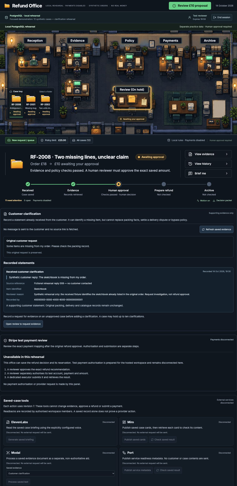

# Customer clarification workflow verification, 14 October 2026

Status: complete for the offline customer clarification scope. Sponsor accounts remain disconnected.

The authorised scope is to receive and record a supporting customer clarification, investigate the case again and return it to Review for a fresh human decision. A clarification may identify an existing order item. It cannot change catalogue prices, packed quantities, delivery records, policy or payment details.

The implementation preserves the original complaint and records each new statement with its source reference and reviewer. A source reference is text, not a request to fetch a website or contact a customer. Contradictory evidence remains a reason to hold the case.

## What is implemented

A reviewer first records an evidence request. On an unapproved case held for evidence, they can then record a received customer statement, identify an existing order item, and add a source reference and reason. The database saves the statement and prior investigation together, clears the outdated recommendation and queues another investigation. The original complaint, catalogue, prices, packing and delivery records stay unchanged.

Statements are immutable. Investigation considers the original complaint alongside all recorded clarifications. The selected item restricts the proposal; selecting it does not by itself establish that it was missing. Policy checks retain the original evidence and amount controls and require the clarification references. Recognised conflicting statements, delivery disputes, packing conflicts and policy holds remain reasons to stop for review.

Recording is reviewer-only and requires the exact saved revision, an explicit evidence hold and no existing approval, operation, receipt or active investigation claim. An uncertain submission retains its exact command. The application independently reads the saved statement before confirming it and accepts a later case revision if investigation has already progressed. A verified immutable reviewer identity is required before the form sends a request.

The original rehearsal remains on migrations 001 and 002. The new evidence rehearsal uses 001, 002 and 007, separate ports, a separate session cookie and its own persistent database. The prepared hosted route requires its explicit capability setting as well as the existing connection and access gates. It has not been tested against a Supabase account.

## Verification results

| Check | Result |
| --- | --- |
| Full application suite | 389 passed, 0 failed |
| Build | Passed |
| Sites worker checks | 4 passed, 0 failed; also included in the application suite |
| Clarification interface checks | 20 passed; included in the application suite |
| Disposable PostgreSQL checks | 53 passed with all seven migrations together |
| Database source verification | All 39 recorded implementation and input files unchanged during the run |
| Database isolation and cleanup | Network disabled, no published ports or existing data mounts; temporary container removed |
| Architecture map | 9 validation checks passed; no errors or warnings; four desktop containment checks passed |
| Current guide links | 174 local links checked across 11 Markdown files |

The database run made 820 SQL round trips and confirmed 159 expected rejections. Its scope includes the original workflow, payment boundaries, hosted contracts and new clarification checks. Provider responses and authentication identities in that disposable test are controlled fixtures; those checks do not establish account access, real JWT verification or live provider acceptance.

The first full application run caught an incomplete advisory-analysis test fixture, which omitted the order reference. The fixture was corrected and the full suite rerun. Integration review also caught a mismatch between local session labels and saved reviewer identities. Local sessions now expose the immutable identity, the form requires it, and interface tests exercise the actual local session response.

## Browser rehearsal

The in-app browser was used because BrowserOS tools were unavailable in this session. All actions were confined to the new evidence rehearsal at [the local clarification office](http://127.0.0.1:4473/).

1. The new focused pack completed its initial investigations: six cases awaited approval, five were held, and one linked to an explicitly seeded historical remedy.
2. RF-2008 was held because its complaint did not identify one of two missing order lines. A reviewer recorded a clearly labelled synthetic evidence request. No customer was contacted.
3. The form received the fictional statement, “Synthetic customer reply: The sketchbook is missing from my order.” Its source and reviewer reason were also explicitly labelled as rehearsal data.
4. Saving queued another investigation automatically. The case reached revision 7 with a £10 recommendation, all eight checks passed, and human approval still required. The saved proposal cited the new clarification.
5. The downloaded decision brief contained the original complaint, new statement, source, reviewer, recording time, both investigation runs and the current approval boundary.
6. Signing out cleared the office. The investigator profile could inspect the recommendation but could not record a clarification or approve a refund.
7. A graceful restart preserved all twelve case records, orders, queue records and the saved clarification exactly. The checkpoint included the new statement table, and the previous session no longer opened the office.

The rehearsal ends with seven cases awaiting approval, four held and one historical remedy. **No new refund approval, reservation or payment was created.** The £10 recommendation is left for the user to decide.

## Preservation and evidence

All twelve cases in the original PostgreSQL rehearsal are unchanged. The fifteen original data files and four earlier preparation archives still match their saved hashes. The other eleven cases in the new rehearsal and its original order catalogue are unchanged. The existing archives were not rebuilt to include this work.

- [Machine-readable verification](../ARTIFACTS.md#excluded-929ec72bf2f428f9)
- [Database verification pointer](../ARTIFACTS.md#excluded-f3a410447ec22e81)
- [Final application test log](../ARTIFACTS.md#excluded-e573dadd5e7fde3f)
- [Build log](../ARTIFACTS.md#excluded-a7bec0138e81893b)
- [Preservation record](../ARTIFACTS.md#excluded-968bad68749b6944)
- [Downloaded decision brief](../ARTIFACTS.md#excluded-f25988e0230775a0)
- [Local rehearsal setup and explicit reuse procedure](LOCAL-POSTGRES-OFFICE.md)

This completes a bounded clarification loop. It does not collect email, contact customers, fetch source links, recognise every natural-language contradiction, correct warehouse records, activate n8n or connect any sponsor service. The local rules remain deliberately limited. Real accounts, hosted authentication, provider calls and deployment still need separately authorised testing.

The previous [payment review verification](verification-payment-review-2026-10-14.md) remains a completed historical record. The architecture map was checked visually in light and dark modes; a manual click-through of every map interaction was not performed.
